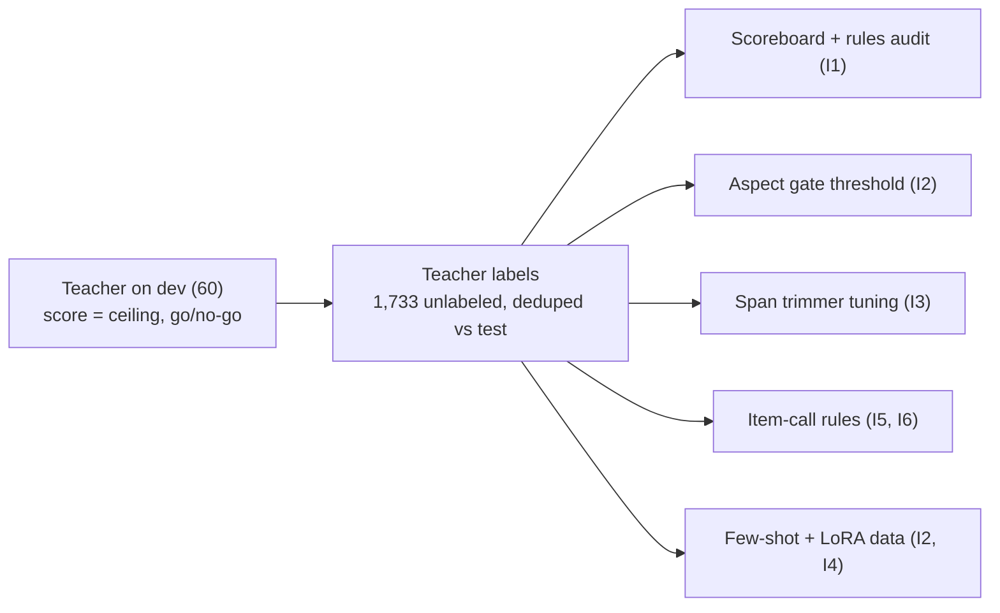

# Ideation: HACK1984 Track 1 score plan

Rules alone score 0.843 on dev. Every point that's left sits in four places: aspects the rules miss, the shape of spans, the actionable call, and signal type. Each is worth about 1 to 3 points on test, and none of them shows up reliably on 60 dev items. So the first job is a scoreboard that can see a 1-point change. Then point the model at clauses, not sentences, and let it add an aspect whenever it's right more often than not.

| Number | What it means |
|---|---|
| 0.843 | dev composite, rules L3 (E009), dev-fitted |
| ±0.055 | dev 95% range: one change of 0.02 is invisible |
| +0.021 to +0.025 | a model finding half the missed aspects at 80% precision (dev simulation, clause spans; E018) |
| ≈0.4 | break-even precision for a new aspect; L3 runs at 1.0 |
| 0.40 → 0.67 | span F1: whole sentence vs best clause, on 46 dev gold aspects |

---

## Codebase Context

### Where we are

It is Saturday 14:00 EST; everything is due Sunday 11:00. `drug track/src/rules/predict.py --level 3` scores 0.843 dev composite (signal 0.856, actionable 0.762, aspect F1 0.617, QWK 0.933, speaker 1.0, span 0.731, citation 1.0). Levels 2 and 3 were written after reading dev answers, so expect test to come in lower. No model has run, the Mac toolchain is untested and there are no teacher labels yet. Decisions in force (`drug track/PROBLEM.md` §0): at most 3B total parameters, Qwen3.5-2B first; frontier teacher labels on the 1,733 unlabeled items are allowed, never on test; rules keep the final say where they fire; self-consistency is rejected.

### Where the dev points are

Each row replaces one part of the L3 output with the gold answer and reports the composite gain. These are ceilings, not forecasts. They show where to dig. Measured on dev with the package's own `score.py` (log row E017). The levers overlap, so the gains don't add.

| Lever (all 60 dev items) | Gain over 0.843 |
|---|---|
| Find the 31 missed aspects (gold polarity, 12-word spans placed on gold) | +0.063 |
| Exact spans on the 25 aspects L3 already finds | +0.038 |
| Actionable right on every item | +0.034 |
| Signal type right on every item | +0.020 |

| Source (gold on every field for that source) | Dev / test items | Gain over 0.843 |
|---|---|---|
| PubMed | 26 / 104 | +0.114 |
| News | 5 / 30 | +0.033 |
| Press release | 7 / 18 | +0.032 |
| fda_event (spans only) | 10 / 37 | +0.011 |
| fda_label | 2 / 10 | +0.004 |
| ctgov | 10 / 40 | +0.000 (already perfect) |

L3 currently predicts no false-positive aspect at all: 25 of 56 gold aspects found, 0 extra.

Other measured facts the ideas lean on:

- **Missed aspects:** PubMed efficacy 10 (mostly +1), PubMed safety 6 (mostly −1), press efficacy 3, press safety 2, press convenience 2, news efficacy 2, the rest single items. Most have no cue word the rules know.
- **Signal errors (8):** 4 are PubMed items gold calls `none` that L3 calls efficacy: a case report on another condition, a tumour-board case, a prognostic model and a screen for another drug.
- **Actionable errors (5):** 4 are missed "yes": VTE prevention with amivantamab, dermatologic management with amivantamab-lazertinib, a real-world frontline study and ADAURA 8-year OS. 1 false "yes".
- **Span shape:** matched PubMed spans score 0.638 against fda_event's 0.811. On the 46 gold aspects in PubMed, news, press and fda_label, the whole containing sentence scores 0.395 span F1, the best clause 0.625, and the best clause cut to 14 words 0.673. Gold press-release spans sit in 76–123-word "sentences" because the headline and navigation text has no full stops.
- **The scorer and extra aspects:** `drug track/scoring/score.py` scores polarity, speaker and span only where gold and prediction both have the aspect (lines 88–96). An aspect gold leaves empty costs only aspect-F1 precision. The lesson doc's line "a wrong extra aspect can hurt up to four parts" holds only for a matched aspect with the wrong polarity or span.
- **Test is not shaped like dev:** test has 30 news items against dev's 5, 10 fda_label against 2, and 1 fda_notice against none. 45 of 60 dev labels were drafted by a frontier model under the guide, then corrected by reviewer rulings.

### Past learnings

`docs/solutions/best-practices/composite-scorer-qwk-cliff-and-matched-only-metrics.md`: the QWK cliff (1.0 with no variation, 0 after one disagreement), never submit zero aspects (0.167), and macro-F1 averages only classes present in gold, so each rare class is worth about 1/63 of the composite. Its "favour precision" advice is right for polarity and spans on matched aspects, but too strict for deciding whether to emit an aspect at all (idea 2).

### What you're researching, and what you aren't

"Research" here means three different things, and they're worth very different amounts of score.

| Kind | Questions | What the answer decides | Status |
|---|---|---|---|
| 1. Measure our own data (most of the value) | How close does the teacher get to dev gold? How do the dev-fitted rules do on silver labels? How precise must an added aspect be? Do sentence or clause spans match gold better? | The model path's ceiling, the gate threshold, the span design, and which rules to trust on test | Headroom, break-even and span-unit numbers measured this run (E017, E018). Teacher-on-dev and rules-on-silver need the teacher run (idea 1) |
| 2. Hands-on checks on the Mac | Versions, JSON-schema decoding, thinking off, a LoRA smoke test, tokens per second | Whether the 2B path is real today, its cost per item, and whether overnight labeling fits | Support confirmed in the source code (mlx-lm has a `qwen3_5` model, llama.cpp a `qwen35` architecture). The rest needs the Mac: idea 4, runbook in `drug track/MAC_CHECK.md` |
| 3. Web research that feeds the score (Tavily/Exa) | Rival EGFR drugs, HTA and payer bodies, guideline bodies, trial name → product | Rare signal classes in news and press releases. Also the Tavily/Exa bonus and the pitch | Not done. Idea 6, logged in `drug track/research/ledger.jsonl` |

**Already looked up this run** (web search only, about 11 searches, value low to moderate):

- A small-model extraction benchmark puts Qwen3.5-2B level with a 2B Granite. IFEval figures disagree across sources.
- Small Qwen3.5 models default to thinking off, but one report says some llama.cpp builds ignore the flag.
- Fine-tuned encoders usually beat small LLMs at classification with a few thousand labels.
- Picking a span by ID can't produce a non-verbatim quote.
- Constrained yes/no token probabilities are better calibrated than asking the model for a confidence.
- Retrieved few-shot examples beat fixed ones, though the evidence for small models is thin.
- The web search found nothing confirming Qwen3.5 support in mlx-lm or llama.cpp. A follow-up look at the source code did: mlx-lm has `mlx_lm/models/qwen3_5.py` (it loads the text model and drops the vision weights), llama.cpp lists a `qwen35` architecture, and ready GGUFs exist (`unsloth/Qwen3.5-2B-GGUF`).

More benchmark reading won't settle the model choice; a run on the Mac will.

**Not worth researching:** anything about test items (ground rules), the full articles behind news snippets (gold spans come from the snippet), and medical facts (the guide says to label what the text says).

---

## Topic Axes

- A. Scoreboard: how decisions get made (dev noise, silver hold-out, teacher calibration)
- B. Aspect recall on PubMed, news and press (the model's job)
- C. Span shape (on aspects already found, and on any new ones)
- D. Item calls: signal type and actionable, including rare classes and the test mix
- E. Model path on the Mac: toolchain, distillation, time

---

## Ranked Ideas

1. [Run the teacher first: score it on dev, then build a silver scoreboard](#1-run-the-teacher-first-score-it-on-dev-then-build-a-silver-scoreboard)
2. [Point the 2B at clauses, and add aspects above about 60% precision](#2-point-the-2b-at-clauses-and-add-aspects-above-about-60-precision)
3. [Fit the span trimmer to silver spans, and split press releases properly](#3-fit-the-span-trimmer-to-silver-spans-and-split-press-releases-properly)
4. [Check the Mac toolchain (20–30 minutes); LoRA only overnight](#4-check-the-mac-toolchain-2030-minutes-lora-only-overnight)
5. [Fix the actionable misses and PubMed "none" items](#5-fix-the-actionable-misses-and-pubmed-none-items)
6. [Build the knowledge pack for rare signal classes in news and press](#6-build-the-knowledge-pack-for-rare-signal-classes-in-news-and-press)

### 1. Run the teacher first: score it on dev, then build a silver scoreboard

**Description:** Make the teacher run the first thing that happens, not milestone M4 at 21:00.
- Prompt the frontier teacher with the full guide and rulings plus same-source dev examples (never the item's own label). Run it on the 60 dev items and log its composite as a row. That number is the realistic ceiling for anything distilled from it, and a go/no-go for the model path.
- Dedupe unlabeled against test (9 fda_event texts appear in both), then label the rest.
- Hold out 300–400 silver items sampled to the test source mix.
- One script scores any predictor on dev, the 15 human-reviewed items and the silver hold-out, prints the change with a bootstrap range, and appends the log row.
- First use: run L2 and L3 on silver and see which dev-fitted rules hold up.

**Axis:** A. Scoreboard

**Basis:** direct: README: "On the rest, a frontier model drafted the labels and we applied the reviewers' rulings" (45 of 60). The log header gives dev's 95% range as ±0.055, while every lever in this doc is worth +0.01 to +0.03, so dev alone can't rank them. PROBLEM §4.3: "Calibrate on dev first." DATA §8: 9 test fda_event texts also appear in unlabeled. Log E006 calls level 2 the "biggest single gain. Dev-fitted."

**Rationale:** Every other idea here needs these labels. The gate threshold (2), span tuning (3), the actionable and rare-class rules (5, 6) and any LoRA data (4) all read silver. If the teacher itself only gets about 0.88 on dev, a 2B copying it has little room over 0.843, and the hours should go to spans, item calls and the demo instead.

**Downsides:** Silver agrees with the drafter's habits, which is mostly what gold is too, so silver gains will overstate true quality. Use it to rank changes, not as truth. It costs API spend and a careful prompt (T3 can run it with North reviewing). It is already in the plan as M4. The change is to make it the first step and to use the dev score as a gate.

**Confidence:** 85%

**Complexity:** Low–Medium (~2 h plus the API run)

### 2. Point the 2B at clauses, and add aspects above about 60% precision

**Description:** The model's job is to find the aspects the rules miss on PubMed, news and press items.
- **Candidates:** the normalizer splits each item into sentences, then clauses (on `;`, `:`, commas and "but / while / whereas"). Press releases split by headline and first paragraphs. Code numbers the clauses.
- **Model output:** under a JSON grammar, the 2B returns `{candidate_id, aspect, polarity}` entries or nothing. It never writes span text, so code quotes the clause verbatim and citation validity stays at 1.0.
- **Gate:** the probability of the constrained choice is the gate score. Emit an aspect when its estimated precision on silver is above about 0.6, and tune the exact cut on composite.
- **Prompt:** the guide section for that source. Once the toolchain works, add 2–3 retrieved same-source silver examples.
- **Fallback:** where the model returns nothing parseable, keep L3's output.

This also answers PROBLEM §13 Q1 (how strict the gate should be) and Q2 (point at clauses, not sentences).

**Axis:** B. Aspect recall

**Basis:** direct: On dev, the whole containing sentence scores 0.395 span F1 against gold and the best clause cut to 14 words scores 0.673 (46 gold aspects). The pointing unit roughly decides whether added aspects help or hurt.

Rerun of the break-even with those clause spans (mean of 40 draws, 80% of polarities exact; E018): a model that recovers half the 31 missed aspects gains

| Precision of added aspects | 1.0 | 0.8 | 0.6 | 0.5 | 0.4 | 0.3 |
|---|---|---|---|---|---|---|
| Composite change, 80% polarity exact | +0.030 | +0.025 | +0.017 | +0.012 | +0.006 | −0.004 |
| Composite change, 60% polarity exact | +0.026 | +0.021 | +0.014 | +0.009 | +0.002 | −0.007 |

Why it's that low: `score.py` lines 88–96 only score polarity, speaker and span on matched aspects, so an extra aspect where gold is empty costs aspect-F1 precision and nothing else.

external: the web research found that ID-based selection can't produce non-verbatim spans, and that constrained-token probabilities are better calibrated than a confidence the model states (thin evidence).

**Rationale:** L3 runs at precision 1.0 with recall 0.45, which is stricter than the composite rewards. Recall matters about as much as precision here: at 0.8 precision, going from a quarter to half of the missed aspects takes the gain from +0.014 to +0.025. Turning the 2B's task into a choice among short, gold-shaped options plays to what small models do reliably.

**Downsides:** The realistic gain is about +0.01 to +0.025 on dev, close to the noise floor, so it can only be judged on silver (idea 1). The 0.673 figure assumes the model picks the best clause. Picking a neighbouring clause scores lower. Abstracts have odd punctuation, and a gold phrase that straddles two clauses only matches in part. It depends on idea 4 passing. The lesson doc's "favour precision" line should be corrected so nobody re-tightens the gate.

**Confidence:** 55%

**Complexity:** Medium (~4–6 h)

### 3. Fit the span trimmer to silver spans, and split press releases properly

**Description:** Choose the trimming rule against hundreds of teacher spans instead of 13 dev ones, then confirm on dev. The rule covers which boundaries cut a clause, the maximum length, and whether to keep subject, verb and cue. Apply it to the rule cues (whose spans are often 2–4 words against gold's 7–12) and to idea 2's candidates. Separately, split press releases into headline, subheads and bullets, so a "sentence" is no longer 100 words of navigation text.

**Axis:** C. Span shape

**Basis:** direct: An oracle span on the 25 aspects L3 already finds is worth +0.038, the largest single lever after missed aspects. Matched PubMed spans score 0.638 against fda_event's 0.811: L3's "manageable safety" (2 words) and "retrospectively analyzed" (2 words) are shorter than gold. Gold press-release spans sit in 76–123-word stretches without full stops (NW-0007, NW-0031, NW-0046). Log E008 widened spans to 16 words and span F1 fell from 0.731 to 0.629, so the length has to be fitted, not guessed.

| Span cut from (46 dev gold aspects on PubMed, news, press, fda_label) | Span F1 |
|---|---|
| Whole sentence containing the claim | 0.395 |
| Best clause, any length | 0.625 |
| Best clause, cut to 14 words | 0.673 |
| L3 cue spans (the 15 of these it finds) | 0.677 |

**Rationale:** It needs no model and no Mac, so North can do it while the toolchain check and teacher run are going. It improves the rules-only submission (the safety net) and idea 2's candidates at the same time.

**Downsides:** Teacher spans may be a little longer or shorter than the drafter's, so check the human-reviewed 15 too. Expect +0.005 to +0.015, invisible on dev alone. Press releases are only 18 test items.

**Confidence:** 65%

**Complexity:** Low–Medium (~2–3 h)

### 4. Check the Mac toolchain (20–30 minutes); LoRA only overnight

**Description:** Before anyone writes model code, check on the Mac that:
- mlx-lm and llama.cpp both load Qwen3.5-2B;
- decoding under a JSON schema or grammar works;
- thinking stays off (check the chat template, not just the flag);
- a 10-step LoRA runs (mlx-lm's default already covers every linear layer in a block, including the hybrid layers' `in_proj_*` and `out_proj`);
- and record tokens per second.

Pin the versions that work. If either runtime fails, switch to the fallback the plan already names (Qwen2.5-3B or Llama-3.2-3B). LoRA on silver runs only overnight behind the G2 gate, and never blocks the daytime path. This answers §13 Q3. The copy-paste runbook for whoever has the Mac is `drug track/MAC_CHECK.md`.

**Axis:** E. Model path

**Basis:** external: The web search couldn't confirm support, but the source code does. mlx-lm has `mlx_lm/models/qwen3_5.py` with the Gated DeltaNet layers. llama.cpp's architecture list includes `qwen35`. `unsloth/Qwen3.5-2B-GGUF` has Q4 to Q8 files. The model is published as image+text, and mlx-lm loads only the text part.

One report says `enable_thinking:false` is ignored in some llama.cpp builds. The community warning that q/k/v/o-only LoRA misses the hybrid layers applies to other trainers: mlx-lm's LoRA defaults to every linear layer in a block. No source gives a clean "LoRA pays off after N examples" figure.

direct: PROBLEM §4.2 already names the fallback models and §10 the G2 gate.

**Rationale:** Support exists in the source code, but versions, JSON decoding and speed on this particular Mac are still unknown. Speed decides idea 2's cost per item and whether labeling about 2,000 items overnight fits. The check costs 20–30 minutes of someone else's time. Keeping LoRA overnight puts the uncertain bet on idle Mac time instead of daytime hours.

**Downsides:** If the fallback model is needed, prompt work starts on a different model. A model bake-off was considered and dropped: the evidence can't separate the candidates, and the fallbacks are already chosen.

**Confidence:** 85%

**Complexity:** Low (20–30 min, then overnight)

### 5. Fix the actionable misses and PubMed "none" items

**Description:** **Actionable:** a prior by source and signal, plus a model "yes" on PubMed and news items that change practice for our own products: pivotal or long-term results, and studies on managing our drug's toxicities. **PubMed "none":** when the abstract's subject is another drug, a prognostic model or an unrelated condition, output signal none with no aspects. Add one question to the 2B's prompt: is osimertinib, amivantamab or lazertinib the subject? Check both fixes on silver before keeping them.

**Axis:** D. Item calls

**Basis:** direct: On dev, 4 of 5 actionable errors are missed "yes" (PM-0005 VTE management with amivantamab, PM-0050 dermatologic management, PM-0022 real-world frontline, NW-0057 ADAURA 8-year OS). An oracle actionable is worth +0.034, the largest item-level lever. 4 of 8 signal errors are PubMed items gold calls none (PM-0028, PM-0035, PM-0064, PM-0090). An oracle signal is worth +0.020. Actionable F1 counts only the "yes" class, so each recovered "yes" counts heavily.

**Rationale:** Both are judgement calls the rules can't make from titles, and both fit naturally as extra fields in idea 2's single call. Together they're worth more than any one rare-class fix.

**Downsides:** Rules fitted to four dev items overfit easily. PM-0005 and PM-0050 have ordinary-looking titles, so a title rule won't find them. A partial fix is worth about +0.01, inside dev noise, so only silver can confirm it.

**Confidence:** 55%

**Complexity:** Low–Medium (~2 h)

### 6. Build the knowledge pack for rare signal classes in news and press

**Description:** Use Tavily and Exa at build time to collect the lists that L2's title cues are missing:
- rival EGFR and NSCLC drugs and their sponsors;
- HTA and payer bodies by country (NICE, HAS, CADTH, PBS, G-BA, IQWiG and others);
- guideline bodies;
- trial name → product.

Feed them to rules for competitor_move (a rival leads the headline), access_pricing (a payer or HTA body acts), guideline and regulatory. Save every result to disk and log it in the ledger. No item text goes into a query.

**Axis:** D. Item calls

**Basis:** direct: Test has 30 news items to dev's 5. DATA §3.6 expects competitor_move and access_pricing there, and dev has one example of each. Macro-F1 averages over the classes present in gold, so each rare class is about 1/9 of signal F1, or 1/63 of the composite. RESEARCH_README §1 already budgets this knowledge pack.

**Rationale:** This is the research that moves the leaderboard, not just the bonus. The same lists also group cards by event and supply cited facts for the pitch.

**Downsides:** The gain depends on the rare classes appearing in test and on titles carrying the cue, and dev can't show either. Check on silver. It takes T3's time from the pitch. Cue lists can misfire on press releases that name rivals in passing (log E007 saw the same with aspect cues).

**Confidence:** 50%

**Complexity:** Medium (~3 h, T3)

---

## Rejection Summary

| # | Idea | Reason rejected |
|---|---|---|
| R1 | Gate aspects at 0.5 precision | The first simulation placed spans on the gold position. Rerun with real clause spans, the break-even rose to ≈0.35–0.4, so the target moved to ≈0.6 (folded into idea 2). |
| R2 | Sentence-number pointers (PROBLEM §4.1.4 as written) | The whole sentence scores 0.395 span F1 against 0.673 for the best clause. Replaced by clause pointers in idea 2. |
| R3 | Per-sentence × aspect scoring with a cached item prefix | A speed trick for idea 2 with a reasoned-only basis. Merged. |
| R4 | Audit the dev-fitted rules on silver (standalone) | It audits against the teacher, not gold, so it's a robustness check rather than a lift. Folded into idea 1 as the scoreboard's first use. |
| R5 | Mine the teacher's spans into a cue lexicon | Duplicates idea 2's recall job and copies teacher bias into rules. Worth revisiting only if the Mac path fails. |
| R6 | Retrieved few-shot examples from silver (standalone) | Optimises a model path that doesn't run yet, on thin evidence. Kept as an option inside idea 2. |
| R7 | Encoder heads (ModernBERT/DeBERTa) on the 3050 Ti | Signal and actionable oracles are only +0.020 and +0.034, so a silver-trained encoder gains less. It's a second training track in 21 hours, and it's unclear whether it counts toward the 3B limit. Cut, as §13 Q4 proposed. |
| R8 | Polarity correction table fitted on silver | Reasoned-only, and it needs student labels that won't exist until late Saturday. |
| R9 | Bake off Qwen3.5-2B against the 3B fallbacks | The evidence can't separate them, and the fallbacks are already chosen. Hours spent for no expected gain. |
| R10 | "Zero-parameter ship" bundle | The same as idea 1's audit plus idea 3. No separate idea. |
| R11 | Extra QWK-cliff hedge | Already in L3: QWK is 0.933 and matched polarities are varied (E009, E010). |
| R12 | fda_event span = first 3 reactions | 0.82 against 0.81 span F1 (DATA §3.2). Noise. |
| R13 | Model judgement for fda_label "cosmetic vs clinical" | Dev oracle +0.004 on 2 items. Too small to plan around; idea 2's prompt can cover it. |
| R14 | Quote attribution for news speakers | Dev news speaker is "media" 4 of 4, and few snippets quote anyone. |
| R15 | Hand-label 100 unlabeled items | Superseded: teacher labels are now allowed and far cheaper per item. |
| R16 | Self-consistency voting on polarity | Rejected in PROBLEM.md decisions in force. |
| R17 | Ask the organisers about encoders and transcript format | Not a score lever. Already PROBLEM §13 Q6 and Q8. |
| - | Gap: transcripts, demo and pitch | Out of scope here. They're judged separately from the leaderboard composite, and no idea here tests transcript-style input. PROBLEM §2 and §8 cover them. |
