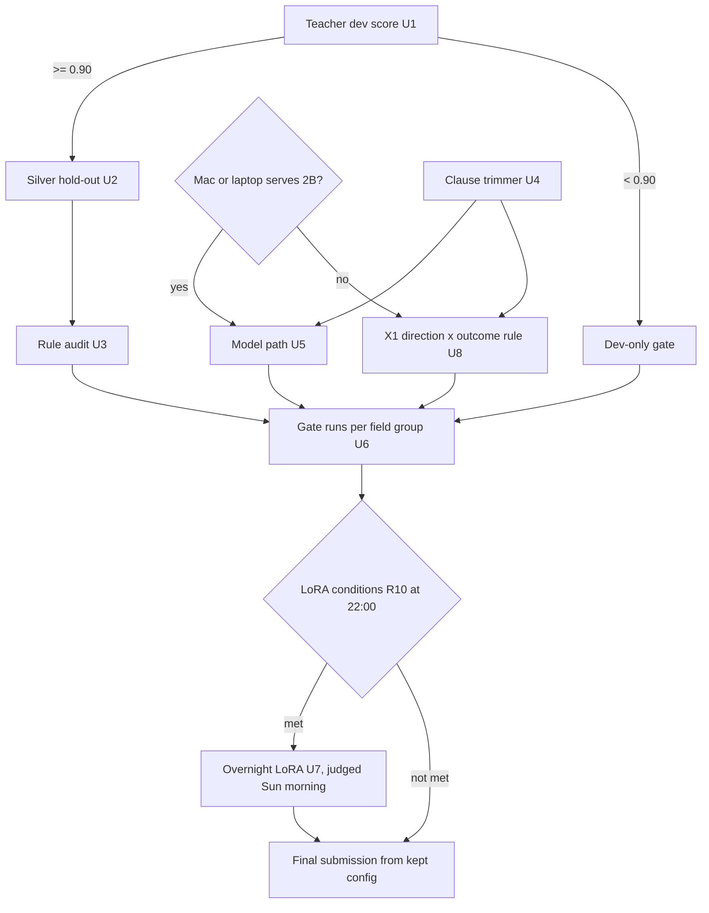
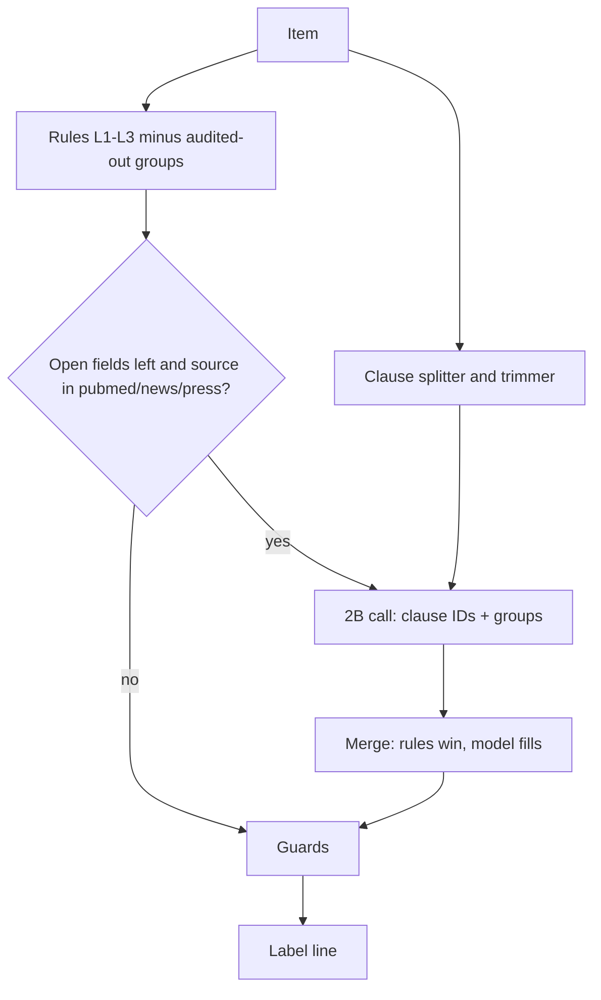

# Score Lift - Plan

> **Partly superseded (Sat 17:10):** the model units (U4, U5, U7) are replaced by the teammate handoff
> `docs/plans/2026-11-07-1710-local-model-handoff.md`, written after the teacher scored 0.874–0.882 on dev (E020–E022).
> U3 (rule audit on silver) is dropped. KTD2, KTD7 and KTD8 still apply.

## Goal Capsule

- **Objective:** The submission we hand in on Sun 2026-11-08 scores higher on the 240 hidden test items than the rules-only L3 submission would, and is never worse than it.
- **Means:** One local 2B call per open item points at numbered clauses and answers three field groups. Each group is kept only if it passes one fixed gate (KTD2), judged on teacher-labelled silver items when the teacher clears its bar (KTD1).
- **Authority:** `drug track/README.md` and `drug track/LABELING_GUIDE.md` win over this plan. `CLAUDE.md` (experiment protocol, test-set rules) wins over this plan. Within this plan, the R-IDs win on behaviour and the KTDs win on mechanism.
- **Stop conditions:** Score work freezes at Sun 06:00 EST. A unit that misses its gate is reverted, not tuned. If the Mac toolchain fails (M1), U5–U7 stop and U8 runs instead.
- **Execution profile:** North alone, on the pipeline lane. The Mac is needed for U5–U7. North's laptop GPU (RTX 3050 Ti, 4 GB) is the backup inference host for a 2B GGUF.
- **Who finishes:** North ships `drug track/out/submission.jsonl`.

---

## Product Contract

### Summary

Build the one model path the lean plan already calls for, with two additions. It answers "actionable?" and "is our drug the subject?" as well as aspects. And every change is judged on a test-shaped silver set, whenever the teacher's dev score earns that. A shared clause trimmer improves spans for the rules and the model alike. An audit removes dev-fitted rules that don't hold up on silver. An overnight LoRA runs only if its conditions are met.

### Problem Frame

The 14:30 lean plan (`docs/ideation/2026-11-07-lean-plan.md`) cut score work, reading E017's 0.904 as the system's ceiling. `docs/solutions/best-practices/dev-oracle-headroom-read-per-lever-and-per-source.md` showed that was the aspect-only ceiling. Gold PubMed fields alone are worth up to +0.114 (E019), and PubMed is 104 of the 240 test items.

Two things push test below the dev figure of 0.843:
- L2 and L3 were fitted to dev.
- Test leans toward the sources where the rules are weakest. Free-text aspect recall is 33% on dev, with news at 30 test items against 5 on dev.

Dev can't rank the remaining levers: each is worth +0.01 to +0.03 against ±0.055 noise. A teacher run on dev (`drug track/src/teacher/gemini_label.py`) is in progress. Its score decides whether we get a better yardstick.

### Requirements

**Measurement**
- R1. The teacher's dev composite is scored and logged as an `info` row before any silver labelling starts. It decides the branch (KTD1).
- R2. The silver hold-out mirrors test's source mix. It excludes every unlabeled item whose text also appears in test, so no test text reaches the teacher (`CLAUDE.md` rule 6).
- R3. Each change is scored once on dev, and on silver when it exists, then logged with `log_exp.py`, kept or not. No sweeps of thresholds or prompts.

**Score levers**
- R4. The model adds aspects only where the rules left the aspect empty. Every model span is a code-quoted clause, so citation validity stays at 1.0.
- R5. For PubMed and news items, the model's "actionable?" and "is our drug the subject?" answers each form their own group, kept or dropped on their own.
- R6. The clause trimmer gives spans to both the rules' cue matches and the model's clause picks.
- R7. With silver, any L2/L3 rule group that lowers silver composite is removed, even if dev drops.

**Protection**
- R8. `drug track/out/submission.jsonl` is always a valid file. It is replaced only by a configuration that passed the gate (PROBLEM.md decision 7).
- R9. Before a swap, the file has 240 lines, every span is an exact substring of its item's text, and matched polarities aren't all one value.

**Overnight**
- R10. The LoRA runs only when the teacher passed, at least about 1,000 non-hold-out silver labels exist by 22:00, and the zero-shot model passed or narrowly missed the aspect gate. Its adapter is kept only if it beats zero-shot on silver.

### Key Decisions

- **No model labelling of the unlabeled corpus.** It doesn't change the score, and the rules' labels in `drug track/out/labels/unlabeled.jsonl` already feed the demo. (session-settled: user-directed, chosen over labelling the corpus with the model overnight: no score benefit, and the demo is already covered.) Governs R10.
- **The teacher is a branch, not an assumption.** Its dev run hasn't returned, so the plan covers both outcomes. Work that doesn't depend on it starts now. (session-settled: user-approved, chosen over waiting to write the plan until the teacher returns: most units don't depend on it.) Governs R1, R7.
- **The night goes to a conditional LoRA.** (session-settled: user-approved, chosen over leaving LoRA cut: the night is the only long idle Mac window, and LoRA is the one lever that needs it.) Governs R10.

### Success Criteria

- With silver: the final configuration's silver composite beats L3's on silver in at least 80% of paired bootstrap resamples, and dev composite is no more than 0.02 below 0.843.
- Without silver: every kept group passed the dev-only gate in KTD2.
- Either way, the submitted file passes R9, and every run has a row in `docs/experiments/log.md`.

### Scope Boundaries

- Transcripts, the AE triage flag, cost per 100 items and the demo stay in the lean plan. This plan's model call (U5) is the one the transcript path reuses.
- Not doing: threshold or prompt sweeps, self-consistency, the 9B, encoder classifiers, the hedge cap (X3), the NLI aspect detector (X4), polarity from token probabilities (X7), retrieved few-shot (X8). Each is sub-noise or already rejected (log, "Ideas already considered").
- Not built: a confidence gate on model aspects. E018 puts break-even precision near 0.35–0.4, and the KTD2 gate already checks precision. Revisit if added aspects come in under 60% right.
- Not built: model labelling of the corpus (see Key Decisions).

### Outstanding Questions

- Deferred: whether the Gemini CLI quota lasts for the training pool after the hold-out. The hold-out goes first (KTD6), so running out only cancels U7.

### Sources

- `docs/experiments/log.md` rows E009, E017, E018, E019 · `docs/solutions/best-practices/dev-oracle-headroom-read-per-lever-and-per-source.md` · `docs/solutions/best-practices/composite-scorer-qwk-cliff-and-matched-only-metrics.md`
- `docs/ideation/2026-11-07-hack1984-score-plan-ideation.md` ideas 1–5 · `drug track/research/reports/B-clinical-claim-polarity.md` pick 1 · `drug track/research/reports/C-grounded-extraction.md` picks 3–4
- `drug track/MAC_CHECK.md` (toolchain runbook)

---

## Planning Contract

### Key Technical Decisions

- KTD1. **Teacher bar: 0.90 dev composite.** That is L3's 0.843 plus the ±0.055 dev noise. At or above the bar, silver is the scoreboard and U2, U3 and U7 become eligible. Below it, there is no silver and those units are dropped. The teacher's few-shot pool comes from dev and never includes the item being labelled, so its dev score is leave-one-out.
- KTD2. **One gate, two forms.** It owns every keep-or-revert call in this plan.
  - *With silver:* keep a change when its silver composite gain over the current kept configuration is positive in at least 80% of 1,000 paired bootstrap resamples, and dev composite drops by no more than 0.02.
  - *Without silver:* keep a change when dev composite drops by no more than 0.02, and at least 60% of the items or aspects the change touches are right against dev gold. That is the lean plan's G1 gate, generalised from aspects to all three groups.
- KTD3. **One call per open item, evidence first.** The schema is `{is_subject, actionable, aspects: [{unit_id, aspect, polarity}]}`, with `unit_id` an enum of the item's clause IDs. JSON-schema decoding is on and the schema is also written into the prompt. Thinking is off and code fences are stripped. The prompt holds the guide section for the item's source and 2–3 same-source dev examples. On dev, the item's own example is excluded. Report C, pick 3: a 2B loses accuracy with a grammar alone.
- KTD4. **Field groups are independent toggles.** Model aspects, model actionable and model subject are each switched on by a flag, with all three default off. Each gets one gate run (KTD2) in the order aspects → subject → actionable. A later group is judged against the configuration that already includes the earlier kept ones.
- KTD5. **The model is a URL.** The client talks to an OpenAI-compatible llama-server endpoint set by an environment variable. The Mac and the laptop GPU are interchangeable, and the pipeline runs with the network off once the server is local.
- KTD6. **Hold-out first, training pool second.** Silver labelling runs the about 237-item hold-out first: PubMed 104, ctgov 40, fda_event 37, news 30, press 18, and all 8 fda_label (unlabeled has no fda_notice). The training pool follows from the remaining items, upweighting news, press and PubMed. The hold-out never enters training or few-shot.
- KTD7. **Merge order: rules, then model, then guards.** Rules keep any field they set. The model fills null aspects and, when its group is on, overrides only `actionable: no` and the default PubMed or news `efficacy` signal. Then the guards run: polarity is clipped to ±1 unless a strong cue (L3's +2 patterns) sits in the quoted clause, fda_event is capped at −1, and the QWK-variety check from R9 applies.
- KTD8. **Trimmer: clause first, then cut around the cue.** Split on `, ; : — (` and before "that", wh-words and subordinating conjunctions. Split on "and/or" only when both sides have 3 or more words. Cut to at most N words and strip trailing punctuation. N starts at 14 (best clause ≤14 words scores 0.673 span F1 on dev). One alternative value, 8, is tried once on silver, not swept. E008 shows that widening without a trimmer hurts, so rule spans change only if the gate passes.

### High-Level Technical Design

Branching on the teacher and the toolchain:



Prediction flow for one item:



### Implementation Constraints

- Never read `drug track/data/test_inputs.full.jsonl` for design. It is opened only to run the final predictor and, in U2, to hash texts for the dedupe. Never send it to Gemini.
- Standard library only for everything outside the model server. pytest isn't installed, so tests use `unittest`.
- Outputs go under `drug track/out/` (gitignored). Code goes under `drug track/src/` and `drug track/tests/` (tracked).

### Sequencing

U4 starts now. U1 starts when the teacher's dev run finishes. U5 starts once M1 (Mac check) passes, or the laptop serves the model. U6 follows U5. U2 and U3 run only if U1 passes. U7 is decided at 22:00. U8 runs only if neither host can serve the model, or on Sunday slack.

---

## Implementation Units

### U1. Score the teacher on dev and pick the branch

- **Goal:** Turn the running teacher job into a logged number and a branch decision.
- **Requirements:** R1, R3
- **Dependencies:** the in-flight `gemini_label.py` dev run
- **Files:** `drug track/out/teacher/dev_gemini.jsonl` (generated), `docs/experiments/log.md` (row via `log_exp.py`)
- **Approach:**
  1. Check the run's `.stats.json` for failures. Rerun only the failed items; the raw cache skips the rest.
  2. Score with `score.py --gold data/dev.jsonl --items data/dev.full.jsonl`.
  3. Log an `info` row with the composite, the human-15 composite and token use.
  4. Apply KTD1.
- **Test expectation:** none. This is a measurement; the log row is the record.
- **Verification:** A log row exists, and the branch (silver or dev-only) is written in its note.

### U2. Silver hold-out, training pool and paired comparison

- **Goal:** A test-shaped silver set, and a tool that says whether one prediction file beats another.
- **Requirements:** R2, R3
- **Dependencies:** U1 passed
- **Files:**
  - `drug track/src/eval/make_silver.py` (dedupe + stratified sample)
  - `drug track/src/eval/compare.py` (score two predictions against the same gold, paired bootstrap)
  - `drug track/tests/test_make_silver.py`, `drug track/tests/test_compare.py`
- **Approach:**
  1. `make_silver.py` hashes normalised test texts and drops matching unlabeled items. Then it samples the KTD6 hold-out with a fixed seed and writes `out/silver/holdout.full.jsonl` and `out/silver/pool.full.jsonl`.
  2. Label the hold-out with `gemini_label.py`, then start the pool in the background.
  3. `compare.py` reuses `scoring/score.py` as a library or subprocess on resampled item sets. It prints both composites, the mean gain and the share of resamples with gain > 0.
- **Patterns to follow:** `drug track/src/eval/score_dev.sh` for paths, and `gemini_label.py`'s refusal of files named "test".
- **Test scenarios:**
  - An unlabeled item whose text matches a test text after whitespace normalisation is excluded from both outputs.
  - Sampling with the same seed twice gives identical item IDs.
  - The hold-out's per-source counts equal the KTD6 targets, or all available items when fewer exist (fda_label).
  - No item ID appears in both hold-out and pool.
  - `compare.py` on two identical prediction files reports gain 0 and a 0% positive share.
  - `compare.py` where file B fixes one wrong signal type reports a positive mean gain.
- **Verification:** The hold-out is labelled. Comparing L3 against itself on silver gives zero gain. L3's silver composite is logged as an `info` row.

### U3. Audit the dev-fitted rules on silver

- **Goal:** Remove the L2/L3 rule groups that don't hold up on test-shaped data.
- **Requirements:** R7, R3
- **Dependencies:** U2
- **Files:** `drug track/src/rules/predict.py` (a flag that disables named rule groups), `drug track/tests/test_predict_groups.py`
- **Approach:** Name the groups once:
  - each L2 title-keyword class (earnings, guideline, access, approval, review, protocol, case report);
  - each L3 cue family (evidence_quality, safety-neutral, safety-positive, efficacy+2, efficacy−1);
  - the real-world downgrade.
  For each group, compare L3 with and without it on silver (`compare.py`), then apply KTD2. Disabled groups become the new default.
- **Patterns to follow:** the existing `level2` / `level3` split in `predict.py`, and `PUBMED_ONLY` as a precedent for a named gate.
- **Test scenarios:**
  - With no groups disabled, output is byte-identical to the current `--level 3` on dev.
  - Disabling the "earnings" group turns an earnings-titled press release back into its level-1 signal.
  - Disabling the safety-positive cue family removes "well-tolerated" safety aspects and nothing else.
- **Verification:** One `info` row per group, and a kept or reverted row for the final disabled set.

### U4. Clause splitter and trimmer

- **Goal:** Numbered, offset-preserving clauses and short spans that score well, for the model's options and the rules' spans.
- **Requirements:** R6, R4
- **Dependencies:** none
- **Files:** `drug track/src/inference/clauses.py`, `drug track/tests/test_clauses.py`, `drug track/src/rules/predict.py` (use the trimmer when `SPAN_MODE` selects it)
- **Approach:**
  1. Split per KTD8. Never cross `…` or `[...]`. Treat press-release headline and navigation runs as their own units by splitting on line breaks and runs of capitalised words.
  2. Each clause carries an ID and character offsets, and its text is the exact substring at those offsets.
  3. Measure best-clause span F1 on the 46 dev free-text gold aspects (target ≥ 0.673 at N = 14), then run the gate on L3 cue spans.
- **Patterns to follow:** `widen()` in `predict.py` (sentence boundaries, verbatim check), and report C pick 4.
- **Test scenarios:**
  - For every dev item, every clause text is an exact substring of the item text at its offsets.
  - "Osimertinib improved PFS, which was consistent with prior data" splits before "which".
  - "A and B" with short sides does not split. "the drug improved survival and the safety profile was manageable" does.
  - A clause longer than N words is cut to N words with no trailing comma or period.
  - Text containing "…" never yields a clause spanning it.
  - An empty text yields no clauses and no error.
- **Verification:** Unit tests pass, the best-clause F1 measurement is logged as `info`, and the L3-trimmed-spans row is logged as kept or reverted.

### U5. The 2B clause-pointer call

- **Goal:** One local call per open PubMed, news or press item that returns valid clause-ID aspects plus the subject and actionable answers.
- **Requirements:** R4, R5
- **Dependencies:** U4, plus M1 passed or the laptop serving a 2B GGUF
- **Files:**
  - `drug track/src/inference/model.py` (prompt, schema, client, parse)
  - `drug track/src/inference/merge.py` (KTD7)
  - `drug track/src/inference/predict_full.py` (rules + model + guards CLI, with the KTD4 flags)
  - `drug track/tests/test_merge.py`, `drug track/tests/test_model_parse.py`
- **Approach:**
  1. Build the prompt per KTD3, then the schema with an item-specific `unit_id` enum.
  2. Call the KTD5 endpoint and parse. On a parse failure or timeout, return no model output for that item, so the rules' output stands.
  3. Cache replies per item, keyed by the prompt hash, so a rerun is free.
  4. Point `export_labels.py`'s label source at `predict_full.py` only after U6 keeps something.
- **Execution note:** Smoke it on 5 dev items before the full dev run, and check that the JSON is valid and the clause IDs exist.
- **Patterns to follow:** `gemini_label.py` (raw-reply cache, fence stripping, stats file), and `MAC_CHECK.md` step 4 (llama-server `json_schema` request shape).
- **Test scenarios:**
  - A reply naming a clause ID that isn't in the enum is dropped, and the item keeps its rules output.
  - A reply wrapped in a ```json fence parses.
  - Merge: the rules set safety and the model also returns safety, so the rules' value stays.
  - Merge: the rules leave efficacy null and the model returns efficacy +1 on clause 3, so the span is clause 3's trimmed text, the speaker comes from the source table, and the span is a substring of the item text.
  - Merge with subject group on: the model says not our drug's subject on a PubMed item the rules called efficacy, so signal becomes none and model-added aspects are removed.
  - Guard: a model +2 on a clause without a strong cue is clipped to +1.
  - With all groups off, `predict_full.py` output on dev is identical to the current rules output.
- **Verification:** The full dev run completes with parse failures under 5% of model calls, logged in the stats file. Tests pass.

### U6. Gate runs and the submission swap

- **Goal:** Decide each field group once and write the submission from the kept configuration.
- **Requirements:** R3, R8, R9
- **Dependencies:** U5 (and U3 when silver exists)
- **Files:** `drug track/src/inference/check_submission.py`, `drug track/tests/test_check_submission.py`, `drug track/out/submission.jsonl` (generated)
- **Approach:**
  1. Run KTD4's three gate runs in order, on dev and silver, and log a row each.
  2. Run the kept configuration on the test inputs locally.
  3. Run `check_submission.py`.
  4. Replace `out/submission.jsonl` only on a pass. Keep the previous file as `out/submission.prev.jsonl`.
- **Test scenarios:**
  - A 239-line file fails.
  - A file with one span that isn't a substring of its item text fails and names the item.
  - A file whose matched-polarity candidates are all −1 is flagged. Matched polarities need gold, so the proxy is "all predicted polarities identical".
  - A valid file passes, and the previous submission is preserved.
- **Verification:** One row per group in the log, `check_submission.py` passes on the swapped file, and `submission.prev.jsonl` exists.

### U7. Overnight LoRA (conditional)

- **Goal:** Use the idle Mac night to distil the teacher into the 2B, kept only if it wins on silver.
- **Requirements:** R10
- **Dependencies:** U2's pool labels, U5, and the R10 conditions true at 22:00
- **Files:** `drug track/src/train/make_lora_data.py`, `drug track/tests/test_make_lora_data.py`
- **Approach:**
  1. Map each pool item to U5's exact prompt.
  2. Build the target from teacher labels. Each teacher span maps to the clause with the highest token overlap. Drop aspects whose best overlap is under 0.5.
  3. Train with `mlx_lm.lora` (settings from `MAC_CHECK.md` step 3, scaled up) under `caffeinate`.
  4. On Sunday morning, score the adapter on the silver hold-out and dev through U6's aspect gate, against zero-shot.
- **Test scenarios:**
  - A teacher span that is exactly one clause maps to that clause's ID.
  - A teacher span with less than 0.5 overlap with any clause is dropped from the target.
  - No hold-out item ID appears in the training file.
  - The prompt text in a training example is identical to what `model.py` builds for the same item.
- **Verification:** The adapter's gate row is logged Sunday by 06:00, kept or reverted.

### U8. PubMed direction × outcome rule (fallback)

- **Goal:** A rules-only source of PubMed polarity and recall, used if no host can serve the model, or on Sunday slack.
- **Requirements:** R4, R3
- **Dependencies:** U4
- **Files:** `drug track/src/rules/predict.py` (a new level or flag), `drug track/tests/test_direction_rule.py`
- **Approach:** Report B pick 1. Pair change words with outcome words (OS, PFS and response, where higher is good; progression, death and AEs, where higher is bad). Significance gives intensity, and our product as the comparator flips the sign. Apply it on PubMed only, take the span from U4's clause, and run the KTD2 gate.
- **Test scenarios:**
  - "significantly prolonged PFS" with osimertinib as the intervention gives efficacy +2.
  - "increased the incidence of grade ≥3 rash" gives safety −1.
  - "no significant difference in OS" gives efficacy 0.
  - A rival beating osimertinib gives −1.
- **Verification:** A gate row is logged as kept or reverted.

---

## Verification Contract

| Check | Command or source | Applies to |
|---|---|---|
| Unit tests | `python3 -m unittest discover -s "drug track/tests"` | U2–U8 |
| Rules on dev | `"drug track/src/eval/score_dev.sh"` | U3, U4, U8 |
| Any predictor on dev | `python3 -I "drug track/scoring/score.py" --gold "drug track/data/dev.jsonl" --pred <file> --items "drug track/data/dev.full.jsonl"` | U1, U5, U6 |
| Paired comparison on silver | `python3 "drug track/src/eval/compare.py"` with silver gold and two prediction files | U3–U8 when silver exists |
| Log every run | `python3 "drug track/src/eval/log_exp.py" --score <score.json> --change "..." --verdict ... --note "..."` | every scored run |
| Submission check | `python3 "drug track/src/inference/check_submission.py" "drug track/out/submission.jsonl"` | U6, before any swap |

---

## Definition of Done

- Every run in this plan has a row in `docs/experiments/log.md`, including reverted ones.
- `drug track/out/submission.jsonl` comes from the last configuration that passed KTD2 and passes `check_submission.py`.
- Unit tests pass.
- The final configuration's flags (field groups on, disabled rule groups, adapter or none) are written in the last kept row's note, so `run_offline.sh` can reproduce it.
- Code from reverted experiments is removed, or left behind a default-off flag that the final configuration doesn't use.
- Any non-obvious lesson (a scorer quirk, a teacher habit) is captured with `/ce-compound`.
