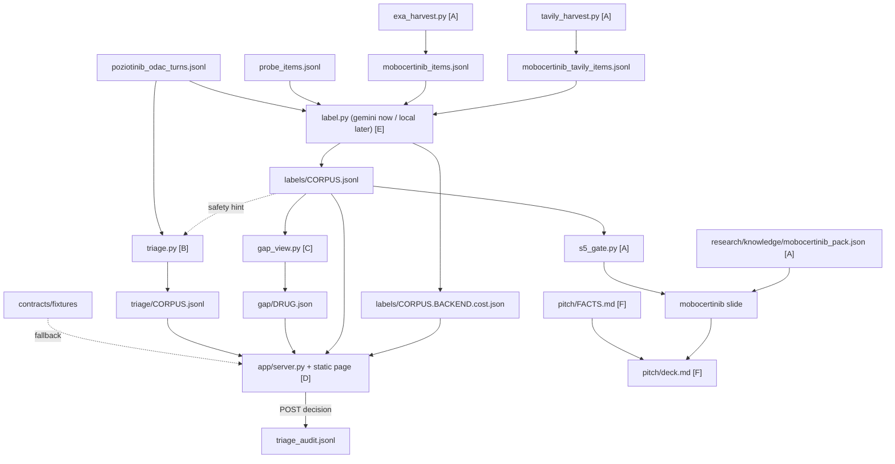
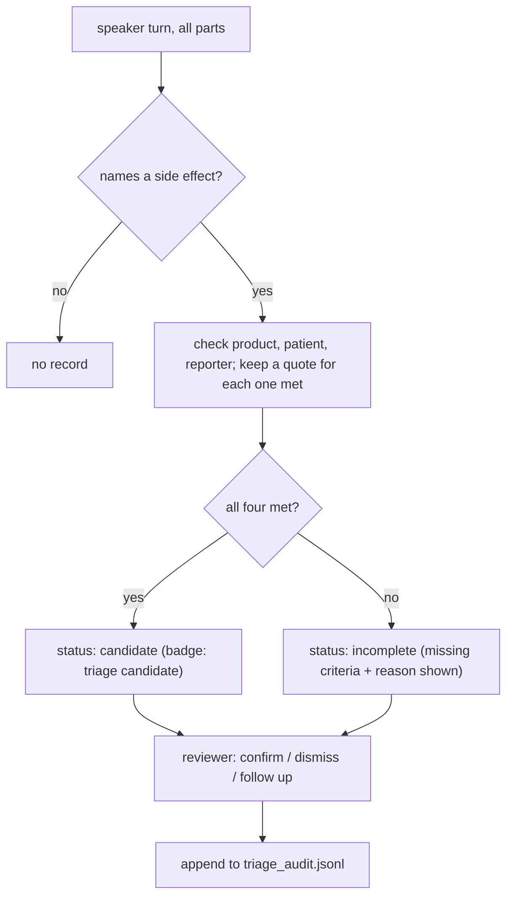

# Startup Lanes - Plan

## Goal Capsule

- **Objective:** At the Sun 2026-11-08 11:00 EST demo, judges see the privacy-first product work on a real expert-meeting transcript. Every label is backed by a quote. Side-effect mentions are checked against the four reporting criteria and logged with an audit trail. Disagreements and silences between regulators, the company, patients and the public record become questions for the next advisory board. Every screen says whether its labels came from the local model or the Gemini stand-in.
- **Means:** six lanes (A–F) built in parallel against fixed file contracts with committed fixtures (KTD1), on Gemini stand-in labels now, with a one-flag swap to the local model later (KD1, KTD2).
- **Authority:** `drug track/README.md` and `drug track/LABELING_GUIDE.md` win over everything. Next comes `CLAUDE.md` (experiment protocol, test-set rules), then `drug track/STARTUP.md` for the product and pitch (its presenter rules in §1 bind lane F), then this plan. Inside this plan, R-IDs win on behaviour and KTDs win on mechanism. The local model itself belongs to `docs/plans/2026-11-07-1710-local-model-handoff.md`.
- **Stop conditions:** Code freezes Sun 09:00. If time runs short, cut in `STARTUP.md` §7 order: U8 (the mobocertinib slide) first, then U3's questions (the gap grid stays), then U7 and U6. Never touch the safety-net `drug track/out/submission.jsonl`. A lane that isn't done by 06:00 ships whatever passes its fixture tests.
- **Execution profile:** three people, network on. Owners are proposed because `PROBLEM.md` §10 roles aren't agreed: North for U1–U3, U11 and U12; T2 for U4 and U5; T3 for U6–U10. U12 needs the Mac and handoff stage 5.
- **Who finishes:** each lane owner lands their units. North runs the final rebuild on the Mac (labels, triage, gap, cost) and the demo build.

---

## Product Contract

### Summary

Build four demo pieces on the transcript and stand-in labels we already have: a rules-based side-effect triage flag with an audit log, a gap view that turns speaker disagreement and thin coverage into advisory-board questions, a localhost UI for both, and a checked pitch deck. In parallel, finish the optional mobocertinib analog slide. File contracts and fixtures come first so the UI never waits on the builders. The local model later replaces Gemini with one flag, and everything downstream rebuilds unchanged.

### Problem Frame

The startup pitch (`drug track/STARTUP.md`) rests on things that don't exist yet. The side-effect flag is the privacy-first core and the way into accounts (§4, §8), but there is no code for it. The gap view is the main reason we need both Tavily/Exa and a local model (ideation idea 1), but its numbers exist only as a table in §6. There's no app at all: `drug track/app/` is absent and nothing in the repo serves a page. The slides depend on facts that still need primary-source checks, and research for this plan found two of them wrong (see Sources).

Three people build this overnight before an 11:00 deadline, mostly in parallel with North's model pipeline. Without fixed formats between the lanes, the UI waits on the builders and every relabel breaks a screen. The labels are Gemini stand-ins for now (`PROBLEM.md` decision 9), so the demo is only honest if each screen says which labeler it shows.

### Requirements

**Shared contracts**

- R1. The triage record, triage audit line, gap view and label-cost files each have a committed JSON Schema and a fixture built from real transcript rows, so the UI can be built and demoed from fixtures alone.
- R2. The rows `drug track/src/startup/label.py` writes keep their current fields, and the startup screens read only those rows plus the files in R1.
- R3. Every screen and derived record shows whether its labels came from the Gemini stand-in or the local model, based on `meta.stand_in`. Nothing derived from stand-in rows is presented as local or network-off output.

**Side-effect triage (lane B)**

- R4. Every transcript speaker turn that names a side effect gets a triage record, whether or not the labeler gave it a safety aspect.
- R5. Each record checks the four ICH E2D(R1) minimum criteria (side effect, suspect product, identifiable patient, identifiable reporter). Every criterion that's met points at an exact quote.
- R6. A record is a "triage candidate" only when all four criteria are met. Otherwise it stays visible and shows which criterion is missing and why. The word "reportable" never appears in a record or on screen.
- R7. A reviewer can confirm or dismiss a record, or mark it for follow-up. Each decision is appended to an audit log with the quotes, source, time, rules and model version, reviewer and decision, and the log survives every rebuild.

**Gap view (lane C)**

- R8. For one drug, the gap view shows count, mean polarity and quotes per aspect, for each transcript speaker group and for that drug's public record.
- R9. It flags thin aspects (too few mentions on one side) and split aspects (columns that disagree). Each flag yields a template question for the next advisory board that cites the evidence behind it.

**Demo UI (lane D)**

- R10. The demo shows labeled transcript turns with highlighted quotes, the triage panel with its four criteria, and the gap view with its questions. It is served from localhost and makes no network requests.
- R11. The UI shows cost per 100 items for each labeling run whose cost file exists.

**Mobocertinib analog (lane A, optional)**

- R12. A quarterly mobocertinib harvest covering 2021–2024 adds dated public items. It is deduped against the test set and the probe, and every call is logged in the ledger.
- R13. A pack lists mobocertinib's names, trials, rivals and a dated timeline, each entry with a source URL.
- R14. The S5 gate chooses between a dated event-timeline slide (the default) and a sentiment curve. The curve is used only if every quarter from 2022-Q1 to 2023-Q3 has at least 5 non-neutral aspects. The slide names the stand-in labeler when its labels came from one.

**Pitch (lane F)**

- R15. Every number and claim on a slide has a primary source and a check date in a fact sheet. Claims that fail the check are corrected or dropped.
- R16. The deck has the 25-second close and 3–4 slides drawn from `STARTUP.md` §1, §4, §8 and §10, and follows its presenter rules.

**Local swap (lane E)**

- R17. `label.py --backend local` writes the same rows with `meta.stand_in: false`, and the triage, gap and cost files rebuild from them with no other change.
- R18. The rebuilt demo path (label → triage → gap → app) runs with the network off on the demo laptop.

### Key Decisions

- KD1. **The network stays on, Gemini stands in for the local model, and `--backend local` swaps it later.** (session-settled: user-directed — chosen over building the offline path first: the startup lanes can't wait for the trained 2B; `PROBLEM.md` decision 9.) Governs R3, R17, R18.
- KD2. **The flag checks every turn that names a side effect, not only turns the labeler scored on safety.** (session-settled: user-approved — chosen over lean plan item 6's "when safety is non-neutral" gate: 26 of the 80 transcript turns that name a side effect have no safety aspect in the stand-in labels, including a "my husband" turn.) Governs R4.
- KD3. **The gap view compares the poziotinib transcript with poziotinib's own public coverage (43 probe items).** (session-settled: user-approved — chosen over Tagrisso/Rybrevant public items: rows only line up when both sides discuss the same drug.) Governs R8.
- KD4. **Reviewer decisions go to an append-only log through a small local server.** (session-settled: user-approved — chosen over static files, where a decision would vanish on reload.) Governs R7, R10.
- KD5. **Lane A's slide says its labels came from the Gemini stand-in unless lane E relabels it in time.** (session-settled: user-approved — chosen over showing it unlabeled.) Governs R14.
- KD6. **"Doesn't fire" means no candidate badge, not a hidden record.** Market-research guidance forwards group-level side effects too (EPHMRA 2024 §3.2, ABPI/BHBIA 2021 §3.2.2), so an incomplete record stays on screen with its missing criterion named. Governs R6.

### Acceptance Examples

- AE1. **Covers R4, R5, R6.** The record for speaker turn `ODAC22-T151` (Mr. Filipiak, open public hearing, parts 1–3) is a triage candidate. Its quotes are: side effect "diarrhea" (`ODAC22-T151-2`), product "poziotinib" (`ODAC22-T151-1`), patient "My wife" (`ODAC22-T151-2`) or "my wife Bobbi" (`ODAC22-T151-1`), reporter "My name is James Filipiak" (`ODAC22-T151-1`). Its safety hint is +1, which is why a sentiment tool would miss it.
- AE2. **Covers R5, R6.** The record covering `ODAC22-T054-6` (Dr. Malinou, FDA presentation) meets the side-effect, product and reporter criteria but not identifiable patient. Its only patient mentions are group statistics ("82 percent of patients", "one quarter of patients"). It shows no candidate badge, and the patient criterion's reason quotes the group statement.
- AE3. **Covers R4.** `ODAC22-T147-1` ("My husband…", open public hearing) has no safety aspect in the stand-in labels but names a side effect, so it still gets a record.
- AE4. **Covers R8, R9.** On the current stand-in labels, the poziotinib gap view raises four flags:
  - split on efficacy: FDA −1.2 (n=15) against open public hearing +1.3 (n=13);
  - split on safety: FDA −1.33 (n=18) against applicant +0.50 (n=18). The public hearing (+0.45) and the public record (−1.0) show in the same row of cells;
  - thin on access/cost: zero mentions on either side;
  - thin on convenience on the public side: 3 public items.
- AE5. **Covers R3, R17.** A gap cell built from stand-in rows shows the stand-in badge. After U12 relabels locally and the files rebuild, the same cell shows no badge.

### Success Criteria

- The demo pair works live: `ODAC22-T151-2`'s turn shows four quoted criteria and the candidate badge, and `ODAC22-T054-6` shows no badge with the missing-patient reason.
- T2 built the screens against fixtures without waiting on U2 or U3, and switching to real outputs needed no UI change.
- No slide carries a number without a row in the fact sheet.
- If U12 lands: the network-off run shows local labels with no stand-in badge anywhere.

### Scope Boundaries

- Not in this plan: the live Tavily demo moment (`STARTUP.md` §7 demo step 3), mock transcripts (lean plan item 5), the signal feed and trends screens (`PROBLEM.md` §8 P0, T2's main-app work), score work, and training the local model (handoff plan).
- The flag supports the reviewer's triage. It doesn't assess seriousness or expectedness, code terms to MedDRA, or draft follow-up questions. Those stay with the safety team.

#### Deferred to Follow-Up Work

- A gap view on Tagrisso/Rybrevant public items (`drug track/out/labels/*`). The builder takes any label-row file, but no demo step needs it.
- Exa find-similar discovery of further analog launches (`STARTUP.md` §5).

#### Considered and not built

- **Tamper-evident (hash-chained) audit log.** The demo has one reviewer on one laptop, so an append-only file with a per-decision snapshot is enough. That changes if a pilot customer's QA requires tamper evidence.
- **Reviewer login.** It's a single local user. That changes for a multi-user pilot.
- **Model-based side-effect detection.** A term list plus the patient and product rules covers the demo pair and runs offline. Its recall is unmeasured, which the pitch says plainly (`STARTUP.md` §4: "triage candidate", never "reportable").
- **Working out which of two named drugs caused a side effect.** v1 takes the first focus-product mention, and the reviewer decides. That changes if real advisory-board transcripts often compare drugs turn by turn.

### Sources

- ICH E2D(R1) Step 4, adopted 15 Sep 2025: four minimum criteria (§2.2). §6.1 says an identifiable patient needs "enough information to indicate the existence of a specific patient", and that "a report referring to a definite number of patients should not be regarded as a case" ("Twenty patients experienced…", "a few patients experienced…"). <https://database.ich.org/sites/default/files/ICH_E2D(R1)_Step4_FinalGuideline_2025_0819.pdf>; FDA edition <https://www.fda.gov/media/176977/download>, which also names market research, sentiment analysis and social listening as organised data collection systems. Shapes KTD5.
- EPHMRA Adverse Event Reporting Guidelines (July 2024) §3.2 counts an "identifiable patient or group of patients". ABPI/BHBIA market-research notes (Feb 2021) §3.2.2 forward side effects "whether or not specific patient identifiers are present". ABPI digital guidance records the awareness date and recommends passing a case to safety within one business day. Shapes KD6 and KTD6.
- Pierce et al., Drug Safety 2017 (PMC5362648): 935,246 posts, 98,252 that resembled side-effect reports, 13 *posts* sent for causality review after three months of manual curation. Fact for U9.
- Mobocertinib dates: EMA says Takeda withdrew the EU application on **20 Jul 2022** (EMA Exkivity page). OncLive reported on **2 Oct 2023** that the US withdrawal followed EXCLAIM-2 missing PFS, with "no new safety signals". The gap is about 14 months, not the 15 in `STARTUP.md` §6. Fact for U7, U8 and U9.
- Gemini 3.6 Flash costs $0.75 / $3.75 per 1M input/output tokens at the introductory rate through 2026-12-31, then $1.50 / $7.50 (Google Cloud model-garden pricing, checked 2026-11-07). The ODAC run used 776,236 input and 26,409 output tokens for 226 turns, about $0.30 per 100 turns. Input to U11.
- Name check: no company or product called "Signal-to-Dose" turned up in three Tavily queries or an Exa company search. This was not a trademark search. Input to U9.
- Raw passages: `drug track/research/raw/exa-plan-startup-*.json` and `tav-plan-startup-*.json` (gitignored). Ledger rows dated 2026-11-07T23:44Z.

---

## Planning Contract

### Key Technical Decisions

- KTD1. **Contracts first: committed schemas plus fixtures cut from real rows, and the app falls back to fixtures with a visible "fixture data" label.** (session-settled: user-approved — chosen over making the UI owner run the pipeline: `drug track/out/` is gitignored.) Builders' tests validate their real output against the same schemas, so fixture and real data can't drift apart. Covers R1.
- KTD2. **`label.py` rows stay as they are, and `meta.stand_in` is the only stand-in signal.** (session-settled: user-directed — chosen over a new row format for the startup corpora: the analysis and the UI already read these rows, and the local backend must write the same file.) Each derived file carries a `provenance` block copied from its inputs and is stand-in whenever any input row is. Covers R2, R3, R17.
- KTD3. **Triage runs as rules over the turn text, offline and independent of the labeler. The labeler's safety aspect is shown only as a hint.** Inherits KD2's label (session-settled: user-approved — chosen over gating on the safety aspect: a labeler miss would hide a case). Covers R4. A useful side effect for the pitch: the flag already runs with the network off today, before the 2B lands.
- KTD4. **One case per speaker turn.** `transcript_turns.py` cuts long turns at about 200 words, so "my wife Bobbi" (`T151-1`) and "diarrhea" (`T151-2`) land in different rows. Each criterion's evidence can come from any part of the turn and carries its own `item_id`. The source text is the full turns file (`drug track/out/startup/poziotinib_odac_turns.jsonl`), not just the 226 labeled rows.
- KTD5. **The four criteria follow ICH E2D(R1) §6.1.**
  - *Side effect:* a term from a curated list of side-effect terms, including lay words, kept beside the builder (e.g. diarrhea, rash, paronychia, pneumonitis, stomatitis, nausea, fatigue, "side effects", "adverse event", "toxicity").
  - *Suspect product:* the corpus's focus product names, or "the drug" / "this drug" / "the medication". A rival named alone doesn't count.
  - *Identifiable patient:* one specific person. That means a possessive relation ("my wife", "my mom"); "my patient", "a patient of mine", "one of my patients" or "I had a patient"; a single person with an age or sex ("a 62-year-old woman"); or a first-person account from a speaker whose role is patient. Plural and group references never qualify on their own ("patients", "my patients", "82 percent of patients", "a few patients"). "One of my patients" is the singular exception listed above.
  - *Identifiable reporter:* the turn has a named speaker. The evidence is their self-introduction if the turn has one, otherwise the `speaker_name` field.
  - *Evidence order:* each criterion lists every match. Named side-effect terms come before the generic phrases ("side effects", "adverse event", "toxicity"), and ties go in turn order. The UI shows `evidence[0]`. For `T151` this puts "diarrhea" (`T151-2`) first, ahead of the generic "side effects" in `T151-1`.
- KTD6. **Triage records are rebuilt freely, and reviewer decisions go to a separate append-only `drug track/out/startup/triage_audit.jsonl`.** Only the app's decision endpoint writes it. Each line snapshots the case's status, evidence and provenance. A confirming decision's `decided_at` is the awareness date (day zero under E2D(R1) §4.3.2). Builders never open the audit file. Inherits KD4's label (session-settled: user-approved — chosen over static files). Covers R7.
- KTD7. **Gap columns and flags.**
  - Columns: `fda`, `committee`, `applicant`, `public_hearing` (transcript `speaker_group` "public", renamed so it isn't confused with the public record), and `public_record` (the drug's public items).
  - Thresholds: `min_n` 3, `split_delta` 1.5, `thin_n` 5. They're stored in the output so the screen can show them.
  - Split: at most one flag per aspect. Among columns with at least `min_n` mentions, it names the highest and lowest means when they differ by at least `split_delta`. A tie goes to the column with more mentions.
  - Sides: the four transcript columns (`fda`, `committee`, `applicant`, `public_hearing`) form the private side, and `public_record` is the public side.
  - Thin: at most one flag per aspect. It is raised when a side has fewer than `thin_n` mentions, and its `side` is `private`, `public` or `both`.
  - Rows with `source: fda_event` are excluded, since they're negative by construction (`STARTUP.md` §7, S6).
  - Inherits KD3's label. Covers R8, R9.
- KTD8. **Template questions are deterministic, with no model call.** There's one template per flag kind, filled with the drug, aspect wording, column labels, means and counts. Each question cites one quote per side, choosing the quote whose polarity is nearest that column's mean. A thin flag with no quotes cites the counts instead. The output is offline and reproducible, and every question carries evidence. Example: "FDA reviewers rated poziotinib's efficacy −1.2 (15 mentions), but patients at the public hearing rated it +1.3 (13). Which view matches what your patients see, and why?" Covers R9.
- KTD9. **Demo app: FastAPI, as `PROBLEM.md` §8 already decides, plus one static HTML/JS/CSS page with no CDN scripts or web fonts.** It binds to 127.0.0.1, reads the files on every request so a rebuild shows on reload, and pins its dependencies in `drug track/app/requirements.txt`. FastAPI isn't installed on North's laptop (uvicorn and starlette are), and the Mac needs the same install before the network goes off. Covers R10.
- KTD10. **Tests use the standard library's `unittest` under `drug track/tests/`, with `jsonschema` for contract checks.** pytest isn't installed, and the repo has no tests yet. `jsonschema` 4.26 is installed here and goes in the app's requirements for the Mac.
- KTD11. **S1 reuses `drug track/src/startup/exa_harvest.py` with a new query file and one new option.**
  - The query file `queries_mobocertinib.json` uses prefix `MQ`, so IDs never collide with the probe's `MB-` items.
  - A new `--exclude-items` option drops URLs already in `out/startup/probe_items.jsonl`, so probe and full harvest can load together without double counting.
  - Gap-filling news for 2022-Q3 to 2023-Q3 comes from a sibling Tavily script. It writes the same item format to its own file, `out/startup/mobocertinib_tavily_items.jsonl`, with prefix `MT`. It applies the same test-set dedupe (RESEARCH_README R6) and appends ledger rows. Research showed date-bounded Tavily news search returns dated 2022–23 coverage.
  - `label.py`'s `mobocertinib` corpus reads both item files and drops repeated URLs before labeling. The labeler's caches are keyed by `item_id`, so item IDs must be unique across the merged corpus.
  - Covers R12.
- KTD12. **The mobocertinib pack is committed as `drug track/research/knowledge/mobocertinib_pack.json`, not under `out/startup/` as `STARTUP.md` §7 says.** `out/` is gitignored, and the pack is hand-checked facts with URLs, the same kind of file as the knowledge pack in `RESEARCH_README.md` §5A. Covers R13.
- KTD13. **`label.py` writes `<corpus>.<backend>.cost.json` (`gemini` or `local`) after every full run, so the stand-in and local costs sit side by side.** For Gemini it records token counts times a dated price with its source URL. For the local backend it records wall time and hardware. Both record whether the data left the device. A `--limit` run writes `labels/<corpus>.smoke.jsonl` and no cost file. Only a full run replaces `labels/<corpus>.jsonl` and its cost file, by writing a temp file and renaming it. That way a smoke test never overwrites the stand-in labels the demo falls back to. Covers R11. This is lean plan item 8 for the startup corpora. The score path's cost-per-100 measurement stays in the handoff plan.
- KTD14. **The local backend calls the handoff plan's stage-5 model client and builds no prompt of its own, but stage 5 must accept two inputs it currently lacks.**
  - **Focus string:** stage 5's prompts are written for Tagrisso/Rybrevant. The stand-in labels judge poziotinib and mobocertinib only because `label.py` passes `FOCUS` through `gemini_label.focus_block`. The stage-5 prompt builder therefore takes an optional focus string with that same wording, and the local branch passes `FOCUS[focus_key]`.
  - **Aspect speaker:** stage 5 takes speakers from `src/rules/predict.py`'s `SPEAKER` table, which has no `transcript`, `paper` or `document` source. For transcript rows the local branch uses the row's `speaker_role`. For harvested items it uses that table extended with `paper` → researcher and `document` → regulator.
  - The output maps onto the existing row shape, with `meta.labeler` set to `local-<profile>`, `meta.model` to the served tag and quantisation, and `stand_in` false. Covers R17.

### High-Level Technical Design

Data flow across the lanes. Lane letters are in brackets, and dashed edges are later swaps.



Triage decision per speaker turn:



### File Contracts

U1 writes these as JSON Schemas under `drug track/contracts/`. The field lists below bind all lanes from now on, so T2 can start before U1 lands. All paths are under `drug track/`, and every span is an exact substring of the named field at `start`.

| File | Producer | Readers | Schema / fixture |
|---|---|---|---|
| `out/startup/labels/<corpus>.jsonl` | `label.py` (existing) | U2, U3, U5, U8 | `label_row.schema.json` documents today's rows / `fixtures/odac_labels.sample.jsonl` |
| `out/startup/triage/<corpus>.jsonl` | U2 | U4, U5 | `triage_record.schema.json` / `fixtures/triage.sample.jsonl` |
| `out/startup/triage_audit.jsonl` | U4 (POST only) | U4, U5 | `triage_audit.schema.json` / `fixtures/triage_audit.sample.jsonl` |
| `out/startup/gap/<drug>.json` | U3 | U4, U5 | `gap_view.schema.json` / `fixtures/gap_poziotinib.sample.json` |
| `out/startup/labels/<corpus>.<backend>.cost.json` | U11, U12 | U4, U5, U10 | `label_cost.schema.json` / `fixtures/odac.gemini.cost.sample.json` |

**Label row (unchanged):** item fields (`item_id, source, url, published, product, title, text`), transcript fields when present (`speaker_name, speaker_group, speaker_role, section, page, turn, part, words`), track labels (`signal_type, actionable`, five aspects as `{span, polarity, speaker}` or null), and `meta {labeler, model, stand_in, labeled_at}`. Readers ignore unknown keys.

**Triage record:**
- `case_id`: `TRI-<turn_id>`, stable across rebuilds.
- `corpus`, `turn_id`, and `item_ids` (the turn's parts, in order).
- `status`: `candidate` | `incomplete`.
- `criteria`: an object keyed `adverse_event`, `suspect_product`, `identifiable_patient`, `identifiable_reporter`. Each value is `{met, evidence: [Evidence], why}`, where `why` is a short reason when `met` is false and null otherwise.
- `missing`: the keys whose `met` is false.
- `source`: `{url, published, title, speaker_name, speaker_group, speaker_role, section, page}`.
- `texts`: `item_id` mapped to that part's text, so the UI can show context.
- `safety_hint`: `{item_id, polarity, span, labeler, stand_in}` or null.
- `provenance`: `{rules_version, built_at, turns_file, labels_file, labeler, model, stand_in}`. Here `stand_in` refers to the hint's labeler only, because the criteria are rules.
- Evidence: `{item_id, field: "text" | "speaker_name", span, start}`.

**Audit line:**
- `audit_id`: uuid4.
- `case_id`.
- `decision`: `confirmed_candidate` | `dismissed` | `needs_follow_up`.
- `reviewer`: free text, default "demo reviewer".
- `note`: string or null.
- `decided_at`: ISO 8601 with offset. For `confirmed_candidate` this is the awareness date.
- `snapshot`: the record's `status`, `criteria`, `source` at decision time.
- `provenance`: the record's provenance plus `app_version`.

**Gap view:**
- `drug`, `built_at`.
- `provenance`: `{inputs: [{file, side, rows, labelers, stand_in}], stand_in}`.
- `thresholds`: `{min_n, split_delta, thin_n}`.
- `columns`: `[{key, label, side, n_rows}]`.
- `aspects`: the five keys, in order.
- `cells`: `[{aspect, column, n, mean, quotes: [{item_id, span, polarity, url}]}]`. `mean` is null when `n` is 0, and there are at most 5 quotes, nearest to the mean first.
- `flags`: `[{flag_id, kind: "thin" | "split", aspect, side, columns, delta, detail, evidence}]`. `side` is `private`, `public` or `both` on thin flags and null on split flags.
- `questions`: `[{question_id, flag_id, text, citations: [{item_id, span, url, column}], counts}]`.

**Label cost:** `corpus, backend, labeler, model, stand_in, items, wall_s, tokens {input, output} | null, price {input_per_m, output_per_m, source_url, checked} | null, usd_total, usd_per_100, s_per_100, data_left_device, hardware, measured_at`.

### Sequencing

| Time (EST) | North | T2 (app) | T3 (research, pitch) |
|---|---|---|---|
| Sat 19:00–20:30 | U1, U11 | U4 scaffold from the field lists above | U6 harvest and label run; start U9 |
| 20:30–24:00 | U2, U3 (between handoff stages) | U4, then U5 on fixtures | U7; U9 |
| Overnight | Mac model work per the handoff plan | — | — |
| Sun 06:00–08:30 | Copy `drug track/out/startup/` to the Mac, since git doesn't carry it. On the Mac, rerun only triage, gap and cost, and relabel only with `--backend local` (U12, if stage 5 is ready) | U5 on real outputs; walk the demo pair | U8; U10 |
| 09:00 | Code freeze | App runs on the Mac | Facts frozen |

### Risks and Dependencies

| Risk | Mitigation |
|---|---|
| North carries U1–U3 and U11–U12 on top of the model pipeline | U1 lands first, so U2 and U3 can move to T2 or T3 if the handoff stages slip. Both are pure Python with fixture-backed tests. |
| The side-effect term list misses wording, and its recall is unmeasured | Incomplete records stay visible (KD6). The pitch says "triage candidate". The reviewer still sees every turn that has a side-effect term. |
| The patient rule fires on a hypothetical ("if my patient got a rash…") | The reviewer decides, and the dismissal is logged. This is acceptable for a triage aid. |
| Handoff stage 5 misses the 09:00 freeze, so U12 can't run | The demo runs on stand-in labels with badges (R3). The flag and gap math still run offline, and the presenter says so. |
| Slide facts are wrong: "15 months" should be about 14, the EPHMRA year (STARTUP says 2025, the version found is July 2024), and Pierce counts posts, not cases | U9 corrects them before U10 uses them (R15). |
| A FastAPI install on the Mac fails with the network off | Install from `drug track/app/requirements.txt` on the Mac before going offline, as part of U4's verification. |

### Open Questions

Nothing here blocks implementation.

- Owners for T2 and T3 (`PROBLEM.md` §10 is still a draft).
- The slide tool (Google Slides, Keynote or a slides artifact) is the deck owner's choice. `drug track/pitch/deck.md` stays the source of the text.
- Which Gemini price page matches the key's billing (Developer API or Google Cloud)? U11 records the page it used.
- Is there a 2025 revision of EPHMRA's AE guidelines? U9 checks, and otherwise cites July 2024.

---

## Output Structure

```text
drug track/
  contracts/
    README.md                       # producer, readers and path for each file
    label_row.schema.json
    triage_record.schema.json
    triage_audit.schema.json
    gap_view.schema.json
    label_cost.schema.json
    validate.py                     # fixtures always; real outputs when present
    fixtures/
      odac_labels.sample.jsonl      # T147-1, T151-1..3, T054-6 and a few neutral turns
      triage.sample.jsonl
      triage_audit.sample.jsonl
      gap_poziotinib.sample.json
      odac.gemini.cost.sample.json
  src/startup/
    triage.py                       # new (U2)
    ae_terms.json                   # new (U2)
    gap_view.py                     # new (U3)
    queries_mobocertinib.json       # new (U6)
    tavily_harvest.py               # new (U6)
    s5_gate.py                      # new (U8)
    exa_harvest.py                  # --exclude-items (U6)
    label.py                        # mobocertinib corpus (U6), cost file (U11), local backend (U12)
  research/knowledge/mobocertinib_pack.json   # new (U7)
  app/
    server.py
    requirements.txt
    static/index.html, app.js, app.css
  tests/
    __init__.py                     # empty; unittest discovery needs it on Python 3.14
    test_contracts.py  test_triage.py  test_gap_view.py  test_app_data.py
    test_harvest.py    test_s5_gate.py  test_label_cost.py
  pitch/
    FACTS.md
    deck.md
```

---

## Implementation Units

| U-ID | Title | Key files | Depends on |
|---|---|---|---|
| U1 | Contracts, schemas and fixtures | `drug track/contracts/*`, `drug track/tests/test_contracts.py` | — |
| U2 | Side-effect triage builder (B) | `drug track/src/startup/triage.py`, `ae_terms.json` | U1 |
| U3 | Gap view builder (C) | `drug track/src/startup/gap_view.py` | U1 |
| U4 | Demo app server and audit endpoint (D) | `drug track/app/server.py` | U1 |
| U5 | Demo app screens (D) | `drug track/app/static/*` | U4 |
| U6 | Mobocertinib quarterly harvest and labels (A, S1) | `queries_mobocertinib.json`, `tavily_harvest.py`, `exa_harvest.py`, `label.py` | — |
| U7 | Mobocertinib pack (A, S2) | `drug track/research/knowledge/mobocertinib_pack.json` | — |
| U8 | S5 gate and slide (A) | `drug track/src/startup/s5_gate.py` | U6, U7 |
| U9 | Pitch fact sheet (F) | `drug track/pitch/FACTS.md` | — |
| U10 | Deck and close (F) | `drug track/pitch/deck.md` | U9; U8 optional |
| U11 | Label cost file (E, item 8) | `drug track/src/startup/label.py` | U1 |
| U12 | Local backend swap and offline run (E) | `drug track/src/startup/label.py` | handoff stage 5, U2, U3, U11 |

### Phase 1: contracts (lands first)

### U1. Contracts, schemas and fixtures

- **Goal:** commit the five schemas and the fixtures, so lanes B, C and D build against the same files from tonight.
- **Requirements:** R1, R2, R3.
- **Dependencies:** none.
- **Files:** create everything under `drug track/contracts/` shown in Output Structure, plus an empty `drug track/tests/__init__.py` and `drug track/tests/test_contracts.py`.
- **Approach:**
  1. Write the schemas from the field lists in File Contracts. Use JSON Schema 2020-12, and allow unknown keys on label rows.
  2. Cut `fixtures/odac_labels.sample.jsonl` from real rows in `drug track/out/startup/labels/odac.jsonl`: `ODAC22-T147-1`, `T151-1` to `T151-3`, `T054-6`, and three turns with no safety aspect. The ODAC transcript is a public FDA record, and no test or organiser items go in.
  3. Hand-write the triage, audit, gap and cost fixtures so they match AE1–AE4. Copy quotes from the fixture rows' text with correct `start` offsets.
  4. `validate.py` checks every fixture, plus any real output files that exist, against their schemas. It also checks that every span is an exact substring at its offset.
  5. `README.md` lists path, producer, readers and schema for each file, and repeats R6's wording rule.
- **Patterns to follow:** `drug track/LABELS.md`, the contract doc the UI team already reads; this unit is the startup-side equivalent.
- **Test scenarios:**
  - Each fixture validates against its schema.
  - Every evidence and quote span in the fixtures is an exact substring of its item's field at `start`.
  - A triage fixture with `status: candidate` and a non-empty `missing` fails validation.
  - A cost fixture with `stand_in: true` and `data_left_device: false` fails validation (stand-in data always leaves the device).
  - Real `odac.jsonl` rows, when present, validate against `label_row.schema.json`.
- **Verification:** `validate.py` passes on the fixtures, and T2 confirms the field lists are enough to start U4.

### Phase 2: builders (lanes B, C)

### U2. Side-effect triage builder

- **Goal:** turn every speaker turn that names a side effect into a triage record with four quoted criteria.
- **Requirements:** R4, R5, R6 (KD2, KD6, KTD3, KTD4, KTD5).
- **Dependencies:** U1.
- **Files:** create `drug track/src/startup/triage.py`, `drug track/src/startup/ae_terms.json` and `drug track/tests/test_triage.py`.
- **Approach:**
  1. Group the rows of the turns file by `turn` into speaker turns.
  2. Join the label rows by `item_id`, used only for the safety hint and provenance.
  3. Apply KTD5. The focus-product names come from a corpus map next to `label.py`'s `FOCUS`; `odac` maps to poziotinib.
  4. Write `drug track/out/startup/triage/<corpus>.jsonl` atomically (temp file, then rename), the same way `export_labels.py` replaces its files.
  5. Sort output by turn order and print counts by status.
- **Execution note:** write the AE1–AE3 tests first, against the fixture rows, before the rules.
- **Patterns to follow:** `drug track/src/startup/label.py` for paths and the `CORPORA` map; `drug track/src/inference/export_labels.py` for atomic replacement.
- **Test scenarios:**
  - Covers AE1. The `ODAC22-T151` turn is a `candidate`, with all four criteria met. Each criterion's `evidence[0]` has the AE1 quote and `item_id`, and the side effect is "diarrhea" from `T151-2`, not the generic "side effects" from `T151-1`.
  - Covers AE2. The turn holding `ODAC22-T054-6` is `incomplete` with `missing == ["identifiable_patient"]`, and its `why` quotes a group statement.
  - Covers AE3. `ODAC22-T147-1` gets a record even though its label row has `safety: null`.
  - "My patients often get rash on poziotinib" (plural) doesn't meet identifiable patient.
  - "One of my patients developed pneumonitis on poziotinib", from a named committee member, is a candidate.
  - A turn naming only mobocertinib, with a side effect and "my patient", doesn't meet suspect product in the `odac` corpus.
  - A turn with "my brother" and no side-effect term gets no record.
  - A missing labels file still produces records, with `safety_hint` null.
  - Rebuilding twice gives identical records apart from `built_at`.
  - No string field in any record contains "reportable".
  - Every output record passes `validate.py`.
- **Verification:** on the real ODAC files, `T151` is a candidate and `T054-6`'s turn is not. The candidate list is short enough for one reviewer to read; report the count.

### U3. Gap view builder

- **Goal:** build the poziotinib gap grid, its flags and its template questions from label rows.
- **Requirements:** R8, R9 (KD3, KTD7, KTD8).
- **Dependencies:** U1.
- **Files:** create `drug track/src/startup/gap_view.py` and `drug track/tests/test_gap_view.py`.
- **Approach:**
  1. Inputs are the private label rows (`labels/odac.jsonl`, grouped by `speaker_group`) and the public label rows (`labels/probe.jsonl` filtered to `product == "poziotinib"`).
  2. Compute cells, then flags per KTD7, then questions per KTD8.
  3. Order flags with splits first (largest delta first), then thin flags.
  4. Write `drug track/out/startup/gap/poziotinib.json` atomically.
  5. The CLI takes the drug and the input files, so it isn't tied to poziotinib.
- **Patterns to follow:** U2's paths and atomic write.
- **Test scenarios:**
  - Covers AE4. On the real stand-in files, when present, the four flags in AE4 appear with the means and counts it lists. Skip with a message when the files are absent.
  - Synthetic rows where two columns with n ≥ 3 differ by exactly 1.5 produce a split flag. A difference of 1.4 doesn't.
  - A column with n = 2 never takes part in a split, however far its mean is.
  - An aspect with zero mentions on both sides gives exactly one thin flag with `side: both`. Its question cites counts and no quote.
  - Rows with `source: fda_event` don't change any cell.
  - Every question has at least one citation or count, and every cited span is verbatim in its item text.
  - Any stand-in input row makes `provenance.stand_in` true. All-local inputs make it false.
  - The output passes `validate.py`, and two runs produce identical files apart from `built_at`.
- **Verification:** the poziotinib JSON shows the AE4 flags, and its questions read as plain sentences a launch team could ask an advisory board.

### Phase 3: demo UI (lane D)

### U4. Demo app server and audit endpoint

- **Goal:** a localhost FastAPI app that serves label rows, triage records with their latest decision, the gap view and cost files, and appends reviewer decisions.
- **Requirements:** R7, R10, R11, R3 (KD4, KTD6, KTD9).
- **Dependencies:** U1. U2, U3 and U11 replace fixtures when they land, with no code change.
- **Files:** create `drug track/app/server.py`, `drug track/app/requirements.txt` (pinned `fastapi`, `uvicorn`, `jsonschema`) and `drug track/tests/test_app_data.py`.
- **Approach:**
  1. A data layer of pure functions loads each file from `drug track/out/startup/` and falls back to `drug track/contracts/fixtures/`. Every response reports `data_source: "real" | "fixture"`.
  2. Read-only endpoints: label rows by corpus, triage records by corpus (each merged with its latest audit decision and decision history), the gap view by drug, and every `<corpus>.<backend>.cost.json`, both backends side by side.
  3. The decision endpoint takes `decision`, `reviewer` and `note`. It checks the decision value and that the case exists. It snapshots the current record, appends one line under a process lock, and returns the updated record. An unknown case returns 404 and a bad decision returns 422.
  4. Serve the static page at `/`. Bind to 127.0.0.1 only.
- **Patterns to follow:** `PROBLEM.md` §8 stack; `drug track/LABELS.md`'s reader guarantees (ignore unknown keys).
- **Test scenarios:**
  - With no real outputs present, each loader returns fixture data and `data_source == "fixture"`.
  - With a real triage file present, the loader prefers it.
  - Appending a decision to an absent audit file creates it. The line passes `triage_audit.schema.json`, and its snapshot equals the record's current criteria.
  - Two decisions on one case leave the latest on the merged record and both in its history.
  - A triage rebuild (replacing the triage file) leaves the audit file and the merged history unchanged.
  - An unknown `case_id` or a decision outside the enum is rejected and writes nothing.
  - A malformed audit line is skipped with a warning, and the other decisions still merge.
- **Verification:** the app starts on the Mac from the pinned requirements, serves the fixtures with the network off, and a decision posted from the page survives a server restart.

### U5. Demo app screens

- **Goal:** three views (Transcript, Triage, Gap) plus cost and labeler badges, covering the demo flow in `STARTUP.md` §7.
- **Requirements:** R3, R6, R10, R11.
- **Dependencies:** U4.
- **Files:** create `drug track/app/static/index.html`, `drug track/app/static/app.js` and `drug track/app/static/app.css`.
- **Approach:**
  - **Header:** the data source ("fixture data" or "real"), and the labeler shown as either "Gemini 3.6 Flash stand-in, network on" or "local <model>, offline". The badge reads the row's `meta.stand_in` or the file's `provenance.stand_in`.
  - **Transcript:** turns with speaker name, group and role chips, and a section filter. Aspects show their polarity, with each quote highlighted at its offset and a "verbatim ✓" mark on substring match. Turns with a triage record carry a marker linking to it.
  - **Triage:** candidates first. Each record shows four criterion boxes, each with its quote, linking back to the turn. A missing box shows its `why`. Records show the safety hint with its own labeler badge. The confirm, dismiss and follow-up buttons take a reviewer name, and the decision history is listed. The badge text is exactly "triage candidate", and no screen says "reportable" (R6).
  - **Gap:** an aspect × column grid with mean and n, coloured on a −2 to +2 scale, with empty cells marked "no mentions". Clicking a cell shows its quotes. Flags are shown next to their cells, and the questions list carries citations that open the quote.
  - **Cost:** a panel per corpus showing labeler, items, cost per 100 (USD for the API, seconds for local) and "data left the device: yes/no". It is hidden when no cost file exists.
  - No external assets: system fonts, and no CDN or analytics.
- **Execution note:** this is mostly UI. Check it by walking the demo pair in a browser on fixtures, then on real outputs, rather than with unit tests.
- **Patterns to follow:** `PROBLEM.md` §8 card and citation behaviour ("verbatim ✓" badge, quote highlight).
- **Test scenarios:** Test expectation: none -- static UI over U4's tested data layer. Verify by walking AE1, AE2, AE3 and AE5 in the browser.
- **Verification:** with the network off on the Mac, the presenter can open `T151-2`, see four quoted criteria and the candidate badge, open `T054-6` and see the missing-patient reason, record a confirm decision, and open the gap view's four questions. A browser devtools network tab shows only localhost requests.

### Phase 4: mobocertinib analog (lane A, optional)

### U6. Mobocertinib quarterly harvest and labels (S1)

- **Goal:** fill the 2022–23 gap in mobocertinib coverage, then label the items with the stand-in.
- **Requirements:** R12 (KTD11).
- **Dependencies:** none. Check `drug track/research/ledger.jsonl` first (CLAUDE.md rule 2).
- **Files:**
  - create `drug track/src/startup/queries_mobocertinib.json`, `drug track/src/startup/tavily_harvest.py` and `drug track/tests/test_harvest.py`;
  - modify `drug track/src/startup/exa_harvest.py` (`--exclude-items`) and `drug track/src/startup/label.py` (a `mobocertinib` corpus).
- **Approach:**
  1. About 25 Exa queries over quarterly date windows from 2021-Q2 to 2024-Q2, generic public terms only (RESEARCH_README R1), at about $0.20.
  2. Tavily news fill with `--topic news` and per-quarter `--start-date`/`--end-date` for 2022-Q3 to 2023-Q3. Adapt results to the item format and write them to `out/startup/mobocertinib_tavily_items.jsonl` with `MT-` IDs, applying the test-set dedupe (RESEARCH_README R6) and adding ledger rows (KTD11).
  3. Add the `mobocertinib` corpus to `label.py`. It reads both item files and drops repeated URLs. Then run it on the stand-in.
- **Patterns to follow:** `exa_harvest.py` (raw saves, ledger row, RESEARCH_README R6 dedupe); `queries_probe.json`.
- **Test scenarios:**
  - `--exclude-items` drops a result whose URL is already in the probe file.
  - New items get `MQ-` (Exa) or `MT-` (Tavily) IDs that never collide with `MB-` IDs.
  - The merged `mobocertinib` corpus has unique item IDs, and a URL found by both Exa and Tavily is labeled once.
  - A Tavily result maps to the item format with `published` as YYYY-MM-DD, or null if missing.
  - A result whose URL, title or text hash matches a test item is dropped and counted (RESEARCH_README R6).
  - No test touches the network; all use canned responses.
- **Verification:** both mobocertinib item files exist with per-quarter counts printed, the ledger has one row per harvest run, and `labels/mobocertinib.jsonl` is written with `meta.stand_in: true`.

### U7. Mobocertinib pack (S2)

- **Goal:** a hand-checked pack of names, trials, rivals and a dated timeline, each entry with a URL.
- **Requirements:** R13 (KTD12).
- **Dependencies:** none. U6's items can supply URLs.
- **Files:** create `drug track/research/knowledge/mobocertinib_pack.json`; add a pack check to `drug track/tests/test_contracts.py`.
- **Approach:**
  - Names: mobocertinib, Exkivity, TAK-788.
  - Trials: EXCLAIM, EXCLAIM-2.
  - Rivals: amivantamab, poziotinib.
  - Timeline, each with its primary URL:
    - US accelerated approval, Sep 2021 (FDA release);
    - EU application withdrawn, 20 Jul 2022 (EMA);
    - EXCLAIM-2 missed PFS and US withdrawal announced, 2 Oct 2023 (Takeda or OncLive), including "no new safety signals".
- **Test scenarios:**
  - Every pack entry has a non-empty `url`.
  - Every timeline date is ISO and the timeline is in date order.
- **Verification:** each URL was opened and agrees with its entry, and the 20 Jul 2022 and 2 Oct 2023 dates match the sources in this plan.

### U8. S5 gate and slide

- **Goal:** decide timeline versus curve from the data, then produce one slide.
- **Requirements:** R14 (KD5).
- **Dependencies:** U6, U7.
- **Files:** create `drug track/src/startup/s5_gate.py` and `drug track/tests/test_s5_gate.py`.
- **Approach:** count non-neutral aspects per quarter across mobocertinib rows (probe plus harvest, deduped by URL), print the gate verdict, and write the quarter table for the slide. The default slide is the dated timeline from U7 with each event's labels. The EU pull is shown as an actionable regulatory signal **about 14 months** before the US withdrawal. If the labels came from Gemini, the slide footnotes "labels: Gemini stand-in".
- **Test scenarios:**
  - Items bucket into calendar quarters by `published`.
  - The gate passes only when every quarter from 2022-Q1 to 2023-Q3 has at least 5 non-neutral aspects. One quarter with 4 fails it.
  - Items without `published` are excluded and counted in the output.
- **Verification:** the verdict is printed and the slide matches it. Its numbers appear in `pitch/FACTS.md`.

### Phase 5: pitch (lane F)

### U9. Pitch fact sheet

- **Goal:** every slide fact has a primary source, a check date and a status.
- **Requirements:** R15.
- **Dependencies:** none. Log any new Tavily/Exa call in the ledger.
- **Files:** create `drug track/pitch/FACTS.md`.
- **Approach:** one table row per claim, with columns for claim, exact slide wording, source URL, check date, and status (ok, corrected, or dropped). Pre-fill from this plan's Sources:
  - E2D(R1) adopted 15 Sep 2025: ok.
  - Pierce 2017: corrected to "13 posts".
  - Mobocertinib gap: corrected to "about 14 months".
  - EPHMRA: check for a 2025 revision, otherwise cite July 2024.
  - Name check: no conflict found; not a trademark search.
  - Still to check: ZoomRx 65% (Fierce Pharma, Apr 2024; Endpoints says "restrict"), the Amgen supplier contract, the Within3 claims (`STARTUP.md` §10, their own claims only) and the Erin Mistry appointment.
- **Test scenarios:** Test expectation: none -- a document. Its check is that every number in `deck.md` has a row here.
- **Verification:** no row has an empty source, and every corrected claim shows its new wording.

### U10. Deck and close

- **Goal:** 3–4 slides plus the 25-second close and the "Built to plug into Within3" slide, worded only from `FACTS.md`.
- **Requirements:** R16 (and R14 if U8 lands).
- **Dependencies:** U9; U8 optional.
- **Files:** create `drug track/pitch/deck.md`, the slide text and speaker notes in whatever tool the owner picks.
- **Approach:**
  - Problem.
  - How it works: public and private sides, same labels.
  - Why privacy is the point: side-effect duty, the triage flag shown live, the IT-approval and cost argument, with the cost per 100 from U11 and U12.
  - Business model and way in.
  - Close.
  - Follow `STARTUP.md` §1's rules: "as if private", no "partner" or "integration", no Within3 logo, "triage candidate" only.
- **Test scenarios:** Test expectation: none -- a document. It's checked against `FACTS.md`.
- **Verification:** a read-through against `FACTS.md` finds no unsourced number, and the close runs in 25 seconds out loud.

### Phase 6: local swap and cost (lane E)

### U11. Label cost file

- **Goal:** each `label.py` run records cost per 100 items, so the UI and the deck can show stand-in versus local.
- **Requirements:** R11 (KTD13).
- **Dependencies:** U1.
- **Files:** modify `drug track/src/startup/label.py`; create `drug track/tests/test_label_cost.py`.
- **Approach:**
  1. After a full Gemini run, read the token totals already in each `*.gemini.jsonl.stats.json`. Price them from a dated price constant that carries its source URL, time the run, and write `labels/<corpus>.gemini.cost.json`.
  2. Apply KTD13's write rules. A `--limit` run writes `labels/<corpus>.smoke.jsonl` and no cost file. A full run replaces the label file and its cost file by writing a temp file and renaming it.
  3. Backfill `odac.gemini.cost.json` and `probe.gemini.cost.json` from the existing stats files, with no relabel.
  4. The local branch is left for U12.
- **Test scenarios:**
  - Covers the Sources figure: 776,236 input and 26,409 output tokens over 226 items at $0.75/$3.75 give about $0.30 per 100.
  - A Gemini cost file has `stand_in: true` and `data_left_device: true`, and passes `label_cost.schema.json`.
  - A `--limit 20` run writes `<corpus>.smoke.jsonl` and leaves `<corpus>.jsonl` and every cost file byte-identical.
  - A missing stats file means no cost file, and the run warns instead of failing.
- **Verification:** `odac.gemini.cost.json` and `probe.gemini.cost.json` exist and appear in the app's cost panel.

### U12. Local backend swap and offline run

- **Goal:** replace the stand-in labels with local-model labels and prove the demo path runs with the network off.
- **Requirements:** R17, R18 (KD1, KTD2, KTD14).
- **Dependencies:** handoff plan stage 5 (model client and server on the Mac), with the focus input KTD14 requires. North adds it while writing stage 5 tonight. Also U2, U3, U11.
- **Files:** modify `drug track/src/startup/label.py` (local branch and local cost record); extend `drug track/tests/test_label_cost.py`.
- **Approach:**
  1. Implement the `local` branch so it calls the stage-5 client per KTD14, passing the focus string and the speaker override.
  2. Copy `drug track/out/startup/` to the Mac first. It's gitignored, and the Mac never reruns Gemini.
  3. Run the S4 smoke test (`STARTUP.md` §7) on 20 turns. It writes `odac.smoke.jsonl` (KTD13), and passes if every reply parses, every quote is verbatim, and the labels pass a quick read. If it fails, stop: the stand-in labels are untouched and the demo keeps its badges.
  4. Relabel `odac`, `probe` and `mobocertinib` with full runs.
  5. Rebuild U2 and U3, and write `<corpus>.local.cost.json` (wall time, hardware, `data_left_device: false`).
  6. With the network off, run label (local) → triage → gap → app.
  7. Record cost per 100 in `STARTUP.md` §6.
- **Test scenarios:**
  - Local rows carry `meta.stand_in: false` and `meta.labeler` starting with `local-`, and pass `label_row.schema.json`.
  - A prompt built for the `odac` corpus contains the poziotinib focus wording, and a local transcript row's aspects take the row's `speaker_role` as speaker.
  - A local cost file has `usd_per_100` null, `s_per_100` set and `data_left_device: false`.
  - Covers AE5. A gap view rebuilt from all-local rows has `provenance.stand_in` false.
- **Verification:** on the demo laptop with the network off, the app shows local labels, no stand-in badge, and the same AE1 and AE2 outcomes.

---

## Verification Contract

| Gate | How | Applies to |
|---|---|---|
| Unit tests | `python3 -m unittest discover -s "drug track/tests" -t "drug track"` | U1–U4, U6–U8, U11, U12 |
| Contract check | `python3 "drug track/contracts/validate.py"`: fixtures always, real outputs when present | U1–U3, U11, U12 |
| Triage build | `python3 "drug track/src/startup/triage.py" --corpus odac` | U2, U12 |
| Gap build | `python3 "drug track/src/startup/gap_view.py" --drug poziotinib` | U3, U12 |
| App smoke | Run uvicorn on 127.0.0.1 from `drug track/app/`, then walk AE1, AE2, AE3 and AE5 in the browser | U4, U5 |
| Offline proof | Network off (Mac Wi-Fi off, or `unshare -rn` on Linux), then label (local) → triage → gap → app | U12 |
| Research hygiene | Every Tavily/Exa call has a row in `drug track/research/ledger.jsonl`, and no query contains item text (RESEARCH_README R1, R6) | U6, U7, U9 |
| Safety net | `drug track/out/submission.jsonl` stays 240 valid lines and is never touched by these units | all |

These units change no dev-scored output, so `score_dev.sh` and `log_exp.py` don't apply. Measured startup facts (cost per 100, S5 verdict, triage counts) go in `drug track/STARTUP.md` §6.

---

## Definition of Done

- **Global:**
  - The demo pair (AE1, AE2) works on the Mac from real outputs.
  - Every screen shows the right labeler badge (R3).
  - The tests and `validate.py` pass.
  - No unsourced number is on a slide.
  - `submission.jsonl` is untouched.
  - Experimental or abandoned code is removed from the diff.
- **U1:** the schemas and fixtures are committed and validate, and T2 has started from them.
- **U2/U3:** real outputs exist, validate, and show AE1–AE4.
- **U4/U5:** the app runs offline on the Mac, and a decision survives a restart.
- **U6–U8 (optional):** the items, pack and verdict exist, and the slide matches the verdict, or the unit was cut in `STARTUP.md` §7 order.
- **U9/U10:** `FACTS.md` covers every deck number, and the close is rehearsed.
- **U11:** cost files exist for every labeled corpus.
- **U12:** the local labels are in place and the offline run passed, or the cut is recorded and the presenter knows to name the stand-in.
